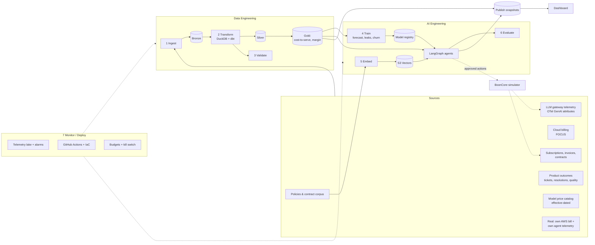
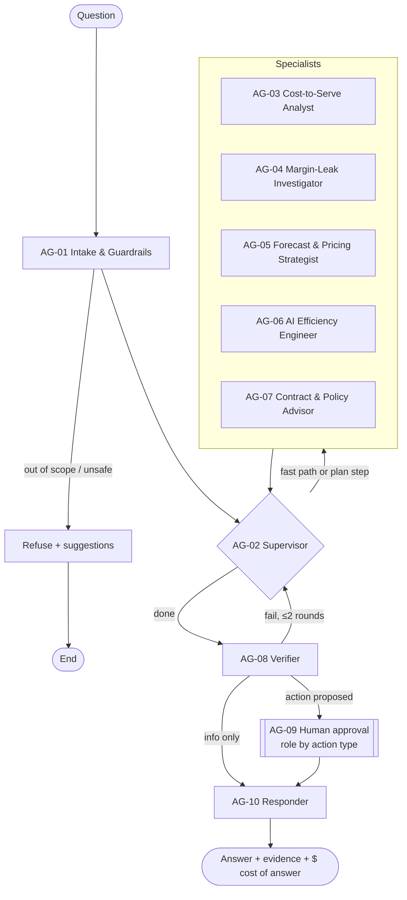
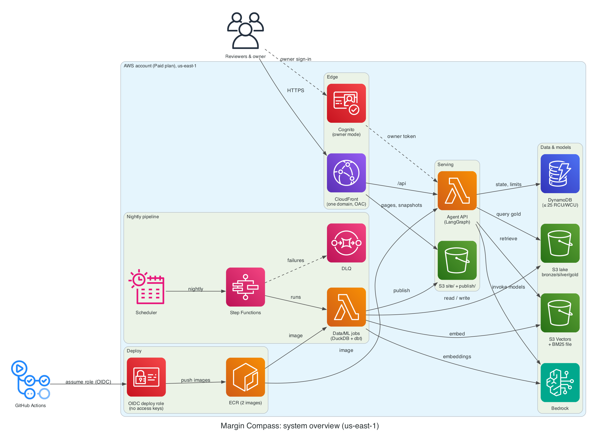

# Margin Compass — Master Plan

> **AI cost-to-serve and gross-margin intelligence for B2B SaaS companies that ship AI features, built on AWS for ~$0/month.**
> A portfolio project that mirrors how an enterprise data & AI platform team designs, builds, evaluates, and operates a multi-agent system end to end, aimed at one specific, current business problem.

| Field | Value |
| --- | --- |
| Document | Master plan (single source of truth) |
| Version | **0.4**: BoonCore vertical set to medtech/imaging technical support (see §20) |
| Status | **M0: Foundations.** No code yet |
| Owner | tojoarisoa |
| Updated | 2026-10-23 |
| Audience | Humans (recruiters, reviewers, engineers) **and** AI coding agents (see `AGENTS.md`) |
| Change policy | Any change to scope, architecture, or budget gets an entry in §18 (Decision Log) and §20 (Change Log) |

---

## Plan at a Glance

Read this first. The rest of the document expands each line.

| Topic | Decision |
| --- | --- |
| Customer | B2B SaaS companies (≈ $10M–$200M ARR) with generative-AI features in production |
| Problem | AI features have made gross margin unpredictable. Companies can't see **which customers and features are profitable after inference costs**, they find margin leaks weeks late, and they set AI pricing by guesswork |
| Solution | Join **LLM usage telemetry + cloud billing + subscription revenue**. Compute daily cost-to-serve and margin per tenant × feature. Detect margin leaks. Simulate pricing and engineering changes. Recommend actions with their margin and quality impact, for a human to approve |
| Not this | A generic cloud-cost dashboard. Infrastructure cost is one input; **the output is margin decisions** |
| Data | Synthetic AI-SaaS company with labeled ground truth, plus the platform's **own real AWS bill and its own agent's LLM telemetry** |
| Lifecycle | Ingest ➔ Transform ➔ Validate ➔ Train ➔ Embed ➔ Evaluate ➔ Monitor/Deploy, orchestrated nightly by Step Functions |
| Models | AI-cost forecaster, margin-leak detector, churn/price-sensitivity model |
| Agents | LangGraph supervisor + **5 specialists** + deterministic verifier + human approval. The LLM never does arithmetic |
| Proof of ROI | **Closed loop**: approved actions change future simulated usage and revenue. Recovered margin is measured against a forecast counterfactual |
| Dashboard | 9 pages; standout features are the **Pricing Simulator** and the **Cost–Quality Lab** |
| Budget | Target ≤ $3/month, hard ceiling $5, with layered guardrails |
| Delivery | Local-first, walking skeleton first, 7 milestones (~14 part-time weeks); portfolio-ready at the end of M4 |

---

## Table of Contents

1. [Executive Summary](#1-executive-summary)
2. [The Business Problem](#2-the-business-problem)
3. [Positioning & Differentiation](#3-positioning--differentiation)
4. [ROI Thesis, Success Metrics & Scope](#4-roi-thesis-success-metrics--scope)
5. [Guiding Principles](#5-guiding-principles)
6. [End-to-End Lifecycle Architecture](#6-end-to-end-lifecycle-architecture)
7. [Data Architecture](#7-data-architecture)
8. [Multi-Agent Architecture (LangGraph)](#8-multi-agent-architecture-langgraph)
9. [Interactive Dashboard](#9-interactive-dashboard)
10. [AWS Reference Architecture](#10-aws-reference-architecture)
11. [The $0 Budget Model & Cost Guardrails](#11-the-0-budget-model--cost-guardrails)
12. [Security, Privacy & Governance](#12-security-privacy--governance)
13. [Evaluation Strategy](#13-evaluation-strategy)
14. [Observability, SLOs & Monitoring](#14-observability-slos--monitoring)
15. [Environments, CI/CD & Release](#15-environments-cicd--release)
16. [Planned Repository Structure](#16-planned-repository-structure)
17. [Delivery Roadmap](#17-delivery-roadmap)
18. [Decision Log (ADRs)](#18-decision-log-adrs)
19. [Risks, Assumptions, Verification & Open Questions](#19-risks-assumptions-verification--open-questions)
20. [Glossary, Sources & Change Log](#20-glossary-sources--change-log)

**ID conventions** (for traceability by humans and agents):

| Prefix | Meaning |
| --- | --- |
| `P-` | Pain points |
| `KPI-` | Success metrics |
| `AG-` | Agents and graph nodes |
| `PG-` | Dashboard pages |
| `ACT-` | Action types |
| `EV-` | Evaluation gates |
| `VER-` | Facts to verify at build time |
| `Mx-yy` | Roadmap tasks |
| `ADR-` | Architecture decisions |

---

## 1. Executive Summary

**The shift.** Software companies are adding generative AI (copilots, autonomous agents, semantic search) to products that were priced for near-zero marginal cost. Every AI interaction now carries a real **inference cost**. Industry analyses report:

- AI-heavy products running gross margins around the **50% range**, compared with the **75–85%** typical of traditional SaaS;
- inference costs that stay a significant share of total spend as companies scale (≈ 23% at the scaling stage);
- a rapid move from seat-based pricing toward **consumption- and outcome-based pricing**.

FinOps practitioners now rank AI cost management as their top future priority, and many organizations report that **no one clearly owns AI cost** (sources in §20.2).

**The problem.** The CFO sees one inference bill per model provider and one cloud bill. The product team sees usage. Finance sees revenue per account. **Nobody sees the three together.** As a result, no one can answer:

- "Which customers lose us money?"
- "Why did AI margin drop 4 points this month?"
- "What happens to margin and churn if we charge per resolution instead of per seat?"

**The solution.** Margin Compass joins LLM gateway telemetry, cloud billing (FOCUS), and subscription revenue to compute **daily, fully loaded cost-to-serve and gross margin per tenant × AI feature × model**. On top of that:

- Trained models forecast AI spend, detect margin leaks, and estimate churn risk from price changes.
- A **LangGraph multi-agent system** investigates leaks, simulates pricing and engineering options, checks them against contracts and policy, and drafts actions. Humans approve every action.
- Every recommendation carries both its **margin impact** and its **quality impact**. Cutting cost by degrading the product is not counted as a saving.

**How it proves value.** Approved actions feed back into the simulated company. Recovered margin is then measured against a forecast of what would have happened without the action. The dashboard reports **margin points recovered** and the platform's ROI multiple next to the platform's own real AWS bill.

**The constraint.** The entire platform runs on AWS for **≤ $5/month (target ≤ $3)**. The platform is itself an AI product, so it measures its own cost per question with the same pipeline it sells.

```text
Ingest ➔ Transform ➔ Validate ➔ Train ➔ Embed ➔ Evaluate ➔ Monitor / Deploy
└──── Data Engineering lifecycle ───┘ └──────── AI Engineering lifecycle ────────┘
```

---

## 2. The Business Problem

### 2.1 Target customer

| Attribute | Profile |
| --- | --- |
| Segment | B2B SaaS, ≈ $10M–$200M ARR, multi-tenant |
| AI maturity | 1–5 generative-AI features in production, using 2+ model providers or tiers |
| Pricing today | Seat-based subscription + a flat "AI add-on"; evaluating usage- or outcome-based pricing |
| Buyer | CFO / VP Finance (economic buyer) |
| Users | VP Product / Pricing, Head of AI Platform, RevOps / Customer Success, FinOps practitioner |
| Trigger events | AI gross margin miss vs plan; board question on AI unit economics; a large renewal; a model provider price change; launching an autonomous-agent feature |

### 2.2 Simulated customer: BoonCore Inc. (fictional)

BoonCore is a B2B AI technical-support platform for **medical device and diagnostics companies**. Its tenants use it to support the hospital equipment teams, lab staff, and service engineers who run their products. **Medical imaging** vendors (CT, MRI, ultrasound, X-ray equipment, and imaging software such as PACS) are the flagship segment: the largest and highest-value group of tenants.

- About **$24M ARR** and **~400 tenant accounts** across Starter, Growth, and Enterprise plans. Imaging vendors are a minority of tenants but the largest share of revenue and AI cost.
- Annual contracts with renewal dates, seat counts, negotiated discounts, **AI usage clauses** (some legacy contracts say "unlimited AI"), **severity-based response-time SLAs**, **approved-model lists**, and **data-residency terms**.
- **Why this vertical:** tenants are highly profitable and each ticket is very high value (a down scanner or analyzer halts clinical schedules; the best outcome is a field-engineer visit avoided). This gives the pricing and engineering levers a large margin pool, while the regulatory constraints below make quality- and contract-guarded savings essential, not optional.

**AI features:**

| ID | Feature | Cost profile |
| --- | --- | --- |
| F0 | **Safety Screening**: screens every ticket for a possible device complaint or patient-harm event and routes positives to the tenant's safety team | Mandatory fixed compliance cost; no lever may weaken it (KPI-08b ≥ 99%) |
| F1 | **Reply Copilot**: drafts replies to equipment and lab staff from approved manuals and instructions for use | High volume, short prompts |
| F2 | **Device Troubleshooting Agent**: multi-step agent that reads device error logs and remote-monitoring telemetry, walks through approved service steps, and resolves the ticket remotely or books a field engineer | Most expensive per interaction; long log-heavy prompts; variable steps; retries |
| F3 | **Service Knowledge Search**: embeddings + retrieval over service manuals, instructions for use, and field safety notices | Embedding and vector costs; re-index spikes on recalls and labeling updates |
| F4 | **Case & Complaint Summaries**: case summaries for tenants' quality records | Batch-friendly but deadline-bound; usually over-served by large models |

**Outcome unit:** a ticket **resolved remotely** (no field-engineer visit), used for per-resolution pricing and cost per outcome (KPI-05).

**Models:** three tiers (small, mid, frontier), possibly from different providers. Prices are effective-dated in a versioned **price catalog** that includes cached-input and batch discounts. A tenant's approved-model list can exclude some providers or tiers.

**Regulatory constraints (simulated; they shape which levers are allowed):**

- **Margin Compass never sees ticket content or patient data.** It ingests only cost, usage, and outcome metadata (AGENTS.md rule 16). The regulation applies to BoonCore's operations and is modeled as constraints on levers.
- **Scope boundary.** BoonCore's AI answers only from approved content and supports equipment and software, never images, diagnoses, or clinical advice. Clinical questions go to a person.
- **Mandatory safety screening.** Every ticket is screened for a possible device complaint or patient-harm event; positives go to the tenant's human safety team within a deadline. This step is a **fixed compliance cost**: no lever may remove it, batch it, or move it to a cheaper model if detection recall drops. Safety-event recall must stay **≥ 99%** (KPI-08), a hard floor alongside resolution quality.
- **Patient data.** Scan images and their DICOM metadata never reach a model; only device logs and error codes, with any patient information redacted first. Routing may only use providers covered by a HIPAA business associate agreement (BAA), per the tenant's approved-model list.
- **Data residency.** Some tenants require EU-only processing.
- **Labeling.** Every view states: synthetic data, not medical advice, not a validated medical system.
- Regulatory and market claims were checked on 2026-11-02 (VER-15, ADR-017). Downtime cost and remote-fix rates are unverified and used only as labeled simulator ranges.

**Injected, labeled patterns** give the models and agents ground truth:

- **Prompt regression**: a release raises tokens per request by 40% on F1.
- **Agent retry loop**: F2 at one tenant after a remote-monitoring connector outage.
- **Silent model upgrade**: F4 moved to the frontier tier with no quality gain.
- **Cache-hit collapse** after a system-prompt change.
- **Re-index storm** on F3 after a recall or field safety notice.
- **Fleet update surge**: a software update pushed to one imaging tenant's scanner fleet floods F2 with near-identical tickets (a cost spike and a caching opportunity).
- **Integration flood**: a hospital system upgrade breaks scanner-to-records integrations, producing tickets with very long integration logs.
- **Blocked cheaper option**: a cheaper model would meet quality, but the tenant's approved-model list (no BAA) or residency terms forbid it.
- **Safety-screening downgrade**: a proposed lever moves safety screening to a cheaper model, lowers recall, and must be rejected by the guardrail.
- **"Power tenants"**: on flat AI add-ons, with a negative margin.
- **Unused cheaper option**: a provider price cut or batch discount that isn't being used.
- **Shared-infrastructure waste**: an idle staging GPU or an oversized vector tier.
- **Seasonality and growth** (hospital fiscal year-end, respiratory-season peaks in diagnostics volume, onboarding waves).
- **Churn behavior** that depends on price changes, used to train and evaluate the churn model.

**Closed loop:** the simulator reads approved actions (§8.4) and applies their effects to future days. Adoption lag, partial realization, quality changes, and churn responses are randomized and labeled.

### 2.3 Pain points

| ID | Pain point | Who feels it | Consequence today | Margin Compass outcome |
| --- | --- | --- | --- | --- |
| P-1 | **Cost-to-serve blindness.** Inference bills arrive per provider or API key, not per tenant or feature; shared infrastructure is unallocated | CFO, FinOps | Gross margin known only in aggregate, after month-end close | Daily cost-to-serve and margin per tenant × feature × model, with ≥ 98% of LLM spend attributed |
| P-2 | **Margin leaks found late.** Prompt regressions, agent loops, silent model upgrades, and cache collapses raise unit cost silently | Head of AI Platform | Discovered on the next invoice, weeks later | Detected in < 24h with an evidence-backed root cause and an estimate of $ lost per day |
| P-3 | **Hidden unprofitable customers.** Flat AI pricing hides heavy users | RevOps, CS, CFO | Renewals negotiated without margin data; "unlimited AI" clauses renewed by default | Ranked tenant margin list; renewal playbooks within discount authority |
| P-4 | **Pricing by guesswork.** The move to usage- or outcome-based pricing is decided without simulation | VP Product / Pricing | Risk of leaving revenue on the table, or of churn | Pricing simulator: revenue, margin, and **churn-risk-adjusted** outcomes per plan design |
| P-5 | **Unmanaged cost vs quality.** Routing, caching, batching, and prompt trimming are applied ad hoc | AI Platform, Product | Cost cuts that quietly degrade the product, or quality kept at any cost | Cost–quality frontier per feature; levers recommended only within a quality guardrail |
| P-6 | **AI COGS can't be forecast.** Inference spend scales with usage and model mix | Finance / FP&A | Missed margin guidance; budget surprises | Probabilistic AI COGS and margin forecast, with what-ifs on model prices and usage growth |
| P-7 | **No owner, no policy.** AI spend has no clear owner; fair-use and discount rules live in documents | CFO, Legal, RevOps | Inconsistent decisions; contract terms ignored | Policy- and contract-grounded checks (with citations) on every action; an audited approval trail |

### 2.4 Jobs to be done

1. *"When AI gross margin moves, tell me why within a day, and how much it costs us per day."* (P-1, P-2)
2. *"Before a renewal, show me the account's true margin, what its contract allows, and a proposal I'm authorized to make."* (P-3, P-7)
3. *"Before we change pricing, show me revenue, margin, and churn under each option."* (P-4)
4. *"Show me where we can cut inference cost without hurting resolution quality, and by how much."* (P-5)
5. *"Give finance an AI COGS forecast it can take to the board."* (P-6)

### 2.5 Personas

- **CFO:** margin overview, forecast, ROI.
- **VP Product / Pricing:** pricing simulator, feature margin.
- **Head of AI Platform:** margin leaks, cost–quality lab, engineering actions.
- **RevOps / Customer Success:** tenant margin, renewal playbooks.
- **FinOps Practitioner:** cost-to-serve explorer, attribution coverage, agent console.
- **Portfolio Reviewer:** a 3-minute guided tour (§9.4).

---

## 3. Positioning & Differentiation

### 3.1 Why not "another FinOps dashboard"

Many open-source FinOps projects stop at the cloud bill: they visualize spend, flag idle resources, and suggest rightsizing. That problem is well covered, and practitioners report that the easy infrastructure waste is largely gone. Margin Compass starts where those tools stop.

| Category (typical focus) | Question it answers | What is usually missing for this customer |
| --- | --- | --- |
| Cloud cost / FinOps tools | "What did our cloud cost, and where is the waste?" | LLM token cost per tenant or feature; revenue; pricing |
| LLM observability / gateways | "What did each prompt or request cost, and how fast was it?" | Shared-infrastructure allocation; revenue and contracts; margin; pricing decisions |
| Usage-based billing platforms | "How do we meter and invoice usage?" | Cost side and margin; leak detection; cost–quality trade-offs |
| **Margin Compass** | **"Which customers and features make or lose money after AI costs, why, and what should we change: price, engineering, or contract?"** | — |

### 3.2 Differentiators (what reviewers should remember)

1. **The unit is margin, not spend.** Cost-to-serve is joined with revenue per tenant × feature, every day.
2. **Three levers in one decision space:** *engineering* (routing, caching, batching, prompts), *commercial* (plan design, caps, overage, outcome pricing), and *account* (renewal terms). Each is scored in margin $.
3. **Quality-guarded savings.** Any lever that drops resolution quality below the guardrail is rejected automatically.
4. **Churn-risk-adjusted pricing.** Pricing scenarios use a trained churn model, not a static elasticity guess.
5. **Contract-aware agents.** Agents retrieve each tenant's contract clauses and the company's discount-authority matrix before proposing anything.
6. **Measured, not claimed.** A closed-loop simulation reports realized margin recovery against a counterfactual.
7. **Industry standards:** FOCUS for cloud billing and OpenTelemetry GenAI semantic conventions for LLM telemetry. The design is portable to real companies.
8. **Dogfooding.** The platform is an AI product too. It reports its own cost per question and its margin per demo "tenant", using its real AWS bill.

### 3.3 Customer benefits (value narrative)

| Benefit | Mechanism | KPI |
| --- | --- | --- |
| Recover gross-margin points | Leak fixes + engineering levers + repricing of unprofitable accounts | KPI-01, KPI-02 |
| Protect revenue while repricing | Churn-risk-adjusted scenarios and renewal playbooks | KPI-09 |
| Faster detection | Daily attribution + leak detector + agent root cause | KPI-06 |
| Predictable COGS | Probabilistic forecast | KPI-07 |
| Accountability | Owners per tenant, feature, and model; approval trail | KPI-03 |

---

## 4. ROI Thesis, Success Metrics & Scope

### 4.1 Value hypotheses (validated in the simulation)

1. Daily tenant × feature attribution plus leak detection cuts **margin-leak MTTD** from ~30 days (invoice cycle) to **< 1 day**.
2. Quality-guarded engineering levers reduce **AI cost per outcome** (per resolved ticket) by **≥ 20%** with quality within 1 point of baseline.
3. Repricing or capping the most unprofitable tenants, with churn risk taken into account, improves blended AI gross margin by **≥ 5 points** without net revenue loss.
4. Together these move BoonCore's AI-feature gross margin from its simulated starting point (~50%, consistent with industry reports) toward **≥ 60%**.
5. The platform costs **< 0.01% of the margin it recovers**.

### 4.2 KPI catalog

| ID | KPI | Definition | Target |
| --- | --- | --- | --- |
| KPI-01 | **AI gross margin %** | (AI-feature revenue − AI cost-to-serve) ÷ AI-feature revenue; blended and per feature | ≥ +8 pts vs baseline by end of the simulation |
| KPI-02 | Margin recovered ($/mo) | Counterfactual cost-to-serve − actual, plus revenue uplift net of simulated churn, over approved actions | Trend ↑; realization rate shown |
| KPI-03 | Attribution coverage | % of LLM spend attributed to tenant × feature (and % of shared infrastructure) | ≥ 98% LLM, ≥ 95% infra |
| KPI-04 | Unprofitable tenants | Count of tenants with negative AI margin, and the ARR they represent | Trend ↓ |
| KPI-05 | Cost per outcome | AI cost-to-serve ÷ resolved tickets (F2) and per assisted reply (F1) | ≥ 20% ↓ within the quality guardrail |
| KPI-06 | Leak detection | Precision, recall, and MTTD against injected labels | P, R ≥ 0.8; MTTD < 24h |
| KPI-07 | AI COGS forecast accuracy | 30-day WAPE per feature vs seasonal-naive and ETS | Beats both; numeric target fixed after M3 |
| KPI-08 | Quality guardrail | (a) Resolution or eval score of recommended configurations vs baseline; (b) **safety-event recall**: share of labeled device-complaint or patient-harm tickets that safety screening flags (§2.2) | (a) ≥ baseline − 1 pt; (b) **≥ 99%**, hard floor (a lever that drops recall below 99% is rejected regardless of savings) |
| KPI-09 | Pricing simulator accuracy | Predicted vs observed (closed-loop) revenue, margin, and churn after a plan change | Error ≤ 10% on revenue and margin |
| KPI-10 | Agent answer accuracy | Golden questions with numbers matching SQL ground truth | ≥ 90% |
| KPI-11 | Agent groundedness | Claims backed by the ledger or citations | ≥ 95%, **0 ungrounded $ figures** |
| KPI-12 | Platform run cost / cost per agent query | Real AWS bill; $ per answered question | ≤ $3/mo; ≤ $0.01 per query |
| KPI-13 | **Platform ROI multiple** | (Margin recovered − Platform cost) ÷ Platform cost | Headline number |

### 4.3 ROI computation rules

- **The LLM never does arithmetic.** Margins, savings, prices, churn-adjusted revenue, NPV, and payback all come from deterministic, unit-tested tools, recorded in the evidence ledger.
- Every recommendation stores its assumptions and shows them: price-catalog version, usage window, quality evidence, churn probability, discount rate.
- Savings count as realized only after a 14-day measurement window. Until then they are "pending verification".

### 4.4 Scope tiers

| Tier | Contents | Milestones |
| --- | --- | --- |
| **MVP: portfolio-ready** | Full data lifecycle; cost-to-serve and margin marts; forecaster, leak detector, churn model; RAG over policies and contracts; online graph with all specialists, verifier, and checkpoints; dashboard PG-1…PG-6, PG-9; budgets and kill switch; CI evaluation gates | M0–M4 |
| **Target** | Nightly margin review graph; closed loop with realized margin; Action Center approvals (visitor sandbox + owner mode); telemetry lake; drift monitoring; red-team suite; guided tour | M5–M6 |
| **Stretch** | Recommendation ranker learned from approvals; MCP server exposing the tools; real LLM-gateway connector (e.g., ingesting OpenTelemetry GenAI spans from any app); Iceberg tables; Slack/email digest | After M6 |

### 4.5 Non-goals

- Metering or invoicing customers. Margin Compass informs pricing; it is not a billing system.
- Being a general cloud-cost optimizer. Infrastructure is allocated and analyzed only as part of cost-to-serve.
- Real-time streaming. Daily batch (with intraday leak checks as a stretch goal) matches how finance decides.
- Changing real systems. Actions are simulated records gated by human approval.
- Fine-tuning or hosting foundation models.

---

## 5. Guiding Principles

1. **Margin is the north star.** Every feature must move or explain a margin KPI. If it doesn't, it is out of scope.
2. **Cost is a first-class requirement for the platform itself** (§11).
3. **Serverless and scale-to-zero.**
4. **Local-first.** The same pipeline, models, and agents run on a laptop (DuckDB on the local filesystem, Ollama). Iteration costs $0.
5. **Walking skeleton first.** Build a thin slice end to end before deepening any stage.
6. **Deterministic core, probabilistic edge.** SQL, models, and calculators produce the facts. Agents orchestrate and explain.
7. **Use a tool when a tool will do.** A capability becomes an agent only if it needs its own reasoning loop.
8. **Quality is a constraint, not a nice-to-have.** No savings are claimed without quality evidence.
9. **Standards over invention.** FOCUS, OpenTelemetry GenAI conventions, dbt, Parquet.
10. **Contracts at every boundary.** Data contracts, typed graph state, versioned tool schemas.
11. **Quality gates block promotion.**
12. **Everything as code.**
13. **Human accountability.** Agents recommend; the right role approves, within its authority.
14. **Honest portfolio.** Synthetic data is labeled as synthetic, sources are cited, limitations are stated.

---

## 6. End-to-End Lifecycle Architecture

### 6.1 High-level flow



**Orchestration.** One Step Functions Standard workflow runs nightly, triggered by EventBridge Scheduler:

1. Ingest
2. Transform
3. Validate
4. Train (weekly, or on drift)
5. Embed (only when the corpus changed)
6. Nightly margin review graph
7. Evaluate
8. Publish

States are kept coarse, about 15 transitions per run.

### 6.2 Stage specifications

#### Stage 1: Ingest

- **Inputs:**

| Source | Content | Shape |
| --- | --- | --- |
| S1 LLM telemetry | Per request: timestamp, tenant, feature, model, provider, input/output/cached tokens, latency, status, retries, agent step count, trace ID, outcome link | Aligned with the OpenTelemetry GenAI semantic conventions (VER-13) |
| S2 Cloud billing | Shared infrastructure, vector storage, GPUs, egress | FOCUS |
| S3 Revenue | Plans, seats, invoices, discounts, overages, contract terms, renewal dates | Billing-system export shape |
| S4 Outcomes | Tickets, AI resolutions, escalations, CSAT, offline evaluation scores by model × feature, safety-screening flag and labeled safety-event ground truth per ticket | Event tables |
| S5 Price catalog | Per model: input/output/cached/batch prices, effective dates | Versioned reference data |
| S6 Corpus | Pricing & packaging policy, discount-authority matrix, fair-use policy, compliance-constraint policy (ADR-017), contract clause library (per-tenant order forms, including approved-model lists, residency, and response-time SLAs), AI cost-optimization playbooks | Markdown / PDF |
| S7 Dogfood | The platform's own AWS Data Exports (FOCUS) and its own agent telemetry | Real |

- **Outputs:** `bronze/<source>/ingest_date=…` plus an ingestion manifest.
- **Patterns:** idempotent loads, late-arrival handling, a dead-letter queue, chunked backfill (19 months, FY2025 through October 2026, in monthly chunks).
- **Gate:** the manifest reconciles (files, rows, schema hash). Schema drift sends the partition to quarantine.

#### Stage 2: Transform

- **Silver:**
  - Conformed telemetry, with token cost priced against the **effective-dated price catalog**.
  - FOCUS billing.
  - Daily-ized revenue (MRR plus usage and overage).
  - Outcomes joined to telemetry by trace ID.
- **Gold:** cost-to-serve and margin marts (§7.3).
- **Allocation:**
  - LLM cost is direct, by tenant and feature.
  - Shared infrastructure uses documented rules (by request share, token share, or storage share per feature).
  - Unattributable cost goes to an explicit "unallocated" bucket that the dashboard shows, never hides.
- **Engine:** DuckDB in Lambda, orchestrated by dbt (dbt-duckdb). Parquet on S3. Tables are also registered in the Glue Data Catalog for optional Athena queries.
- **Semantic metrics layer:** margin, cost per outcome, and attribution coverage are each defined once and shared by the dashboard, the agents, and the evaluations.
- **Gate:**
  - **Cost preservation:** allocated cost-to-serve plus unallocated equals total billed cost, to the cent.
  - **Revenue preservation:** daily-ized revenue equals invoiced revenue per period.

#### Stage 3: Validate

- **Data contracts** for every gold mart; dbt tests.
- **Statistical checks:** volume and distribution drift.
- **Business rules:**
  - No negative tokens.
  - Every request maps to a tenant and a feature.
  - Every price lookup resolves to an effective catalog entry.
  - Every tenant has an active plan.
- **Outputs:** a data-quality scorecard and lineage, both published.
- **Severity:**
  - *Error* stops the pipeline and quarantines the partition.
  - *Warn* continues and annotates the dashboard.

#### Stage 4: Train

| Model | Purpose | Approach | Baselines |
| --- | --- | --- | --- |
| **AI COGS forecaster** | Forecast tokens and $ per feature (and top tenants) with P10/P50/P90 | Global gradient-boosted model with calendar, growth, model-mix, and price-catalog features; hierarchical reconciliation | Seasonal-naive, ETS |
| **Margin-leak detector** | Detect unit-cost shifts (tokens per request, cost per outcome, cache-hit rate, retries per resolution) | Change-point detection + seasonal residual scoring + Isolation Forest; severity in $/day | Static thresholds |
| **Churn / price-sensitivity model** | Probability that a tenant churns or downgrades under a given price change | Calibrated gradient-boosted classifier on tenant features (usage, margin, tenure, plan, seats, CSAT, price change %) | Logistic regression |

- **Where:** a Lambda container job orchestrated by Step Functions. The data is sized to fit Lambda limits (§7.5).
- **Registry:**
  - Artifacts and a model card are stored in S3.
  - Version, metrics, and champion/challenger alias are stored in DynamoDB.
- **Policy:** retrain weekly or on drift. A challenger is promoted only if it beats the champion and the baselines.

#### Stage 5: Embed

- **Corpora:**
  1. Pricing, fair-use, and discount-authority policies, plus the **compliance-constraint policy** (safety-screening floor, BAA-covered providers, data residency; ADR-017).
  2. **Per-tenant contract clauses**, with the tenant ID as metadata.
  3. AI cost-optimization playbooks.
  4. Schema and metric cards.
  5. Episodic memory: past investigations, and decisions to approve or reject.
- **Pipeline:**
  1. Parse.
  2. Structure-aware chunking.
  3. Metadata (source, tenant, clause type, effective date).
  4. Bedrock embeddings.
  5. Upsert into **S3 Vectors**.
  - Content hashes skip unchanged chunks.
- **Retrieval:** vector search with metadata filters (e.g., `tenant_id`, `clause_type`), fused with in-Lambda BM25 over a small index file in S3. S3 Vectors does not provide keyword search itself.
- **Gate:** EV-04 before the index alias is promoted.

#### Stage 6: Evaluate

Evaluation is multi-layer and gating. See §13.

#### Stage 7: Monitor / Deploy

IaC is deployed through GitHub Actions with OIDC (§15). Monitoring uses the telemetry lake plus ≤ 10 alarms (§14). Budgets and the kill switch are covered in §11.

---

## 7. Data Architecture

### 7.1 Storage layout (single S3 bucket, prefix-separated, lifecycle-managed)

| Prefix | Content | Retention |
| --- | --- | --- |
| `bronze/` | Raw landed files | 90 days |
| `silver/` | Conformed facts (Parquet) | 13 months |
| `gold/` | Cost-to-serve and margin marts (Parquet) | 25 months |
| `quarantine/` | Failed partitions | 30 days |
| `models/` | Artifacts + model cards | Last 5 versions |
| `rag/` | Chunk store + BM25 index | Current + previous alias |
| `evals/` | Evaluation results | All |
| `telemetry/` | Compacted platform logs and traces | 90 days |
| `publish/` | Dashboard snapshots (JSON + Parquet) | Latest + 30 days |
| `site/` | Dashboard assets | Latest |

### 7.2 Core entities

The model is built around these entities: **tenant**, **feature** (F0–F4), **model** (tier, provider), **price catalog entry** (effective-dated), **request** (telemetry), **outcome**, **subscription / contract** (including approved-model list, data-residency terms, and severity-based response-time SLAs; ADR-017), **invoice line**, **cost line** (FOCUS), **action**.

The **cost-to-serve identity** is:

> cost-to-serve = LLM token cost + allocated shared infrastructure + vector/storage + third-party APIs

Each tenant × feature × day has exactly one row in the margin fact.

### 7.3 Gold marts

| Mart | Grain | Purpose | Tier |
| --- | --- | --- | --- |
| `fct_llm_usage_daily` | day × tenant × feature × model | Requests, tokens (input/output/cached), priced cost, retries, steps | MVP |
| `fct_infra_cost_allocated` | day × tenant × feature × allocation rule | FOCUS cost allocated to tenants and features | MVP |
| `fct_cost_to_serve` | day × tenant × feature | Fully loaded cost by component | MVP |
| `fct_revenue_daily` | day × tenant × plan component | Subscription, AI add-on, overage, discounts | MVP |
| `fct_tenant_margin` | day × tenant × feature | Revenue, cost-to-serve, gross margin $ and % | MVP |
| `fct_unit_cost` | day × feature × model | Cost per request, per outcome, tokens per request, cache-hit rate | MVP |
| `fct_quality` | day × feature × model | Resolution rate, escalation rate, evaluation score, `safety_events_labeled`, `safety_events_flagged`, `safety_event_recall` (= flagged ÷ labeled; null when no labeled events; KPI-08b is always recomputed from the summed counts over the evaluated period or lever, never by averaging daily ratios) | MVP |
| `fct_margin_leaks` | leak | Detector output, $/day impact, status, RCA link | MVP |
| `fct_forecasts` | forecast date × target date × feature | AI COGS and margin quantiles | MVP |
| `fct_churn_scores` | tenant × scenario | Churn and downgrade probability | MVP |
| `fct_actions` | action | Type (ACT-1/2/3), $ impact, quality impact, risk, status, approver, assumptions | Target |
| `fct_realized_margin` | action × day | Counterfactual vs actual | Target |
| `dim_tenant` (SCD2) | tenant | Plan, seats, segment, renewal date, contract flags (e.g., "unlimited AI") | MVP |
| `dim_feature`, `dim_model_price` (effective-dated), `dim_policy` | entity | Reference data | MVP |
| `agg_exec_kpis` | day | Pre-aggregated KPIs for the dashboard | MVP |

### 7.4 Data contracts & lineage

Each gold mart has a contract: owner, SLA, schema, tests, PII classification (none expected), and consumers. Lineage runs from bronze through gold to the dashboard, agent tools, and models.

### 7.5 Data volume budget

| Item | Budget |
| --- | --- |
| LLM telemetry | Pre-aggregated at the generator to tenant × feature × model × **hour** for Enterprise tenants and × **day** for Starter and Growth, plus a 1% raw request sample for drill-downs. About 2.7M rows over 19 months (measured 2.71M) (hourly for all tenants would be ≈ 13M; BoonCore spec §10) |
| Billing / revenue / outcomes | Under 1M rows each. Outcomes: tenant × day aggregates (severity and feature counts as columns) + per-ticket rows for a 10% sample and every labeled safety event, ≈ 0.79M rows |
| Gold total | ≤ 300 MB Parquet |
| Largest Lambda job | ≤ 6 GB memory, ≤ 10 min |
| `publish/` per page | KPI JSON ≤ 200 KB; exploration Parquet ≤ 5 MB; total ≤ 25 MB |

---

## 8. Multi-Agent Architecture (LangGraph)

### 8.1 Patterns adopted

| Pattern | Where used |
| --- | --- |
| Supervisor routing with a **fast path** | Single-intent questions go straight to one specialist |
| Plan-and-execute | Multi-part questions ("why did F2 margin drop, and what should we do at renewal?") |
| Specialist subgraphs | Private tools and scoped context per specialist |
| Map-reduce fan-out (`Send`) | The nightly margin review processes each leak and each at-risk tenant in parallel |
| Verifier loop | Deterministic checks first, then an LLM claim check; ≤ 2 revision rounds |
| Human-in-the-loop interrupt | Pauses before any action; the approver role depends on the action type |
| Durable checkpoints | DynamoDB checkpointer: resumable threads, audit trail |
| Evidence ledger | Agents may only state numbers that came from tool outputs |
| Model tiering | A small model for routing and simple tasks; a mid-tier model for analysis and synthesis |

### 8.2 Online graph: "Ask Margin Compass"



### 8.3 Agent and node catalog

| ID | Node | Kind | Responsibility | Key tools | Model |
| --- | --- | --- | --- | --- | --- |
| AG-01 | Intake & Guardrails | Mostly deterministic | Scope and injection screening; entities (tenant, feature, model, period, plan) | Rule checks, entity resolver | Small, only when rules are inconclusive |
| AG-02 | Supervisor | LLM | Route or plan; track steps; completion | Plan state | Small |
| AG-03 | **Cost-to-Serve Analyst** | Specialist | "What does tenant X or feature F cost to serve, and what's the margin?" | Semantic metric query; guarded SQL generation over gold | Mid |
| AG-04 | **Margin-Leak Investigator** | Specialist | Root cause of unit-cost shifts: release, model change, tenant behavior, cache, retries | Leak store, drill-down queries, raw-sample traces, release calendar, episodic memory | Mid |
| AG-05 | **Forecast & Pricing Strategist** | Specialist | AI COGS forecast; plan-design scenarios (seat, usage, outcome, caps, overage) with churn-adjusted revenue and margin | Forecast inference, **pricing engine**, churn model, scenario simulator | Mid |
| AG-06 | **AI Efficiency Engineer** | Specialist | Cost–quality levers: routing, caching, batching, prompt trimming, model downgrade, each sized in $ and quality | **Traffic replay simulator** (historical usage × price catalog × quality-by-model), ROI calculators | Mid |
| AG-07 | **Contract & Policy Advisor** | Specialist | What the contract allows; discount authority; fair-use policy; whether a lever is allowed for a tenant (approved-model list, residency, safety-screening floor); renewal proposal drafts | Hybrid retrieval (tenant-filtered), policy rule checks | Small |
| AG-08 | Verifier | Deterministic + LLM | Ledger numeric match; schema; quality guardrail respected; authority respected; citation support | Ledger matcher, guardrail checker, citation checker | Small |
| AG-09 | Human approval | Interrupt | Route to the approver for the action type (§8.4); persist; resume | Approval store | — |
| AG-10 | Responder | LLM | Persona-aware answer, evidence table, cost-of-answer line | — | Mid |

**LLM call budget per question:** typically 3–5, never more than 8. Simple questions take the fast path (about 3 calls).

### 8.4 Action types (simulated, human-approved)

| ID | Action | Example | Approver role | Closed-loop effect |
| --- | --- | --- | --- | --- |
| ACT-1 | **Engineering lever** | "Route F4 summaries to the small tier + batch API" | Head of AI Platform | Changes future model mix, tokens, cost, and quality |
| ACT-2 | **Pricing / packaging change** | "Move the AI add-on to 1,000 included resolutions + $0.60 overage" | Pricing committee (VP Product + CFO) | Changes future revenue; triggers churn and downgrade responses |
| ACT-3 | **Account action** | "At renewal, replace the 'unlimited AI' clause with a fair-use cap; offer a 10% discount (within authority)" | RevOps / CS lead, within the discount-authority matrix | Changes that tenant's revenue, usage, and churn risk |

### 8.5 Batch graph: "Nightly Margin Review" (Target tier)

1. **Fan out** over new margin leaks, tenants with negative or deteriorating margin, and renewals due within 90 days.
2. For each, the relevant specialists investigate, size the opportunity, and check policy and contract, then draft an ACT-1, ACT-2, or ACT-3.
3. **Reduce:** deduplicate and rank by margin $ × confidence ÷ effort, and compute portfolio impact.
4. Write `fct_actions` and the **daily margin brief** to `publish/`.
5. Store investigations in episodic memory.
6. **Cost control:** the nightly LLM budget is capped. Low-severity items are summarized in a single batched call.

### 8.6 State, memory & contracts

- **Typed graph state:**
  - the request and entities;
  - the plan;
  - the **evidence ledger** (tool inputs, outputs, hash, units);
  - the draft answer and verification report;
  - proposed actions;
  - approvals;
  - the LLM-call counter;
  - a token and $ accumulator.
- **Memory:**
  - Thread checkpoints in DynamoDB, with a TTL.
  - Episodic memory in S3 Vectors.
  - Organization preferences in DynamoDB.
- **Tool contracts:** versioned schemas. Every tool is read-only, idempotent, time-bounded, row-limited, and metered.
- **Ledger rule:** if a number is not in the ledger, it cannot appear in the answer.

### 8.7 LLM provider strategy

- Amazon Bedrock on-demand behind a provider abstraction. Model IDs and prices are fixed in ADR-003 after VER-05.
- **Cost levers:**
  1. Fast path.
  2. Tiering.
  3. Prompt caching for stable prompts and schema cards.
  4. A semantic answer cache.
  5. Per-request token ceilings.
  6. Daily and monthly $ budgets enforced in code.
- **Degradation:** when the budget is exhausted, the console serves cached or precomputed answers and the daily brief, clearly labeled.
- **Dogfooding:** the agents emit OpenTelemetry GenAI-style telemetry with a "demo tenant" ID, and that telemetry flows through the same pipeline (S7). The Platform page shows the platform's **own** cost-to-serve per question.
- **Development:** local models via Ollama; CI replays recorded responses (§13).

---

## 9. Interactive Dashboard

### 9.1 Design goals

Executive-grade, fast, mobile-friendly, and accessible (WCAG AA). Every number links to its metric definition, freshness, and lineage.

**Two-speed loading.** KPI pages render from precomputed JSON. In-browser DuckDB-WASM loads lazily, only for exploration and simulation pages.

### 9.2 Pages

| ID | Page | Persona | Key elements & interactions | Tier |
| --- | --- | --- | --- | --- |
| PG-1 | **Executive Margin Overview** | CFO | AI gross margin (blended, per feature) vs plan; margin recovered; cost per outcome; unprofitable tenants and ARR at risk; **ROI multiple**; margin trend with forecast band; daily margin brief | MVP |
| PG-2 | **Cost-to-Serve Explorer** | FinOps, RevOps | Tenant × feature × model drill-down; **per-tenant margin waterfall** (revenue → LLM → infra → vector → third-party → margin); margin-vs-usage scatter that shows power tenants; attribution coverage | MVP |
| PG-3 | **Margin Leaks** | AI Platform | Leak timeline by $/day; detail with RCA narrative, evidence, unit-cost chart, release annotations | MVP |
| PG-4 | **Forecast & Pricing Simulator** | Pricing, Finance | AI COGS fan chart; **plan designer** (seat price, included usage, overage rate, outcome price, caps) → revenue, margin, and churn-adjusted outcome per segment, computed in the browser; compare up to 3 scenarios | MVP |
| PG-5 | **Cost–Quality Lab** | AI Platform, Product | Cost-vs-quality frontier per feature by model and routing policy; lever simulator (routing %, cache, batch, prompt length) with the quality guardrail line | MVP |
| PG-6 | **Agent Console** | All | Streaming chat; **live graph view** (nodes, tools, evidence ledger, tokens and $ per answer); suggested questions per persona | MVP |
| PG-7 | **Action Center** | Approvers | ACT-1/2/3 queues by approver role; approve/reject with rationale; margin waterfall (identified → approved → realized); renewal calendar with playbooks | Target |
| PG-8 | **Platform** | Platform, Reviewer | Tabs: *Pipeline & Data Health*, *AI Quality* (backtests, evaluation trends), *Platform FinOps* (real AWS bill by lifecycle stage, budget burn-down, **the platform's own cost per question**) | MVP |
| PG-9 | **Architecture & About** | Reviewer | Interactive architecture diagram, positioning (§3), ADR highlights, limitations, sources | MVP |

### 9.3 Approvals: visitor sandbox + owner mode

- **Visitor sandbox (public, no sign-in):** reviewers can approve or reject actions. Decisions stay in their own browser, and the margin waterfall is recomputed locally. This costs $0 and doesn't change canonical data.
- **Owner mode (sign-in via Cognito, Target tier):** approvals are written to DynamoDB and drive the closed-loop simulator.

### 9.4 Guided tour for reviewers (3 minutes)

1. Executive Margin Overview
2. The power tenant in the Cost-to-Serve Explorer
3. A margin leak and its root cause
4. The Pricing Simulator: switching from seat to outcome pricing
5. Asking the agent: "What should we do at Tenant X's renewal?"
6. The ROI multiple and the platform's own cost

### 9.5 Technology (planned)

- **App:** static SPA (React + TypeScript + Vite), a financial-grade chart library (e.g., Apache ECharts), and a design system with light and dark themes.
- **Hosting:** S3 + CloudFront. The agent API sits behind the same distribution (one domain, no CORS).
- **Shared calculation logic:** the pricing and lever simulators in the browser use the **same calculation specification** as the agents' tools, and parity tests keep them in sync, so the dashboard and agents never disagree.
- **Performance budget:** KPI pages interactive in ≤ 2.5s on 4G; simulation and exploration pages in ≤ 5s.

---

## 10. AWS Reference Architecture

### 10.1 Service map



Architecture diagrams are generated from code in `docs/diagrams/` and embedded in the relevant ADRs.

| Concern | Service | Notes |
| --- | --- | --- |
| Scheduling | EventBridge Scheduler | Schedules in `dev` are off by default |
| Orchestration | Step Functions **Standard** | Coarse states; no Express |
| Compute | Lambda | Two container images (data/ML, agents/API) plus zip functions for small tasks |
| Images | ECR | Keeps the last 3 images per repository |
| Lake | S3 | One bucket, lifecycle rules |
| Ad-hoc SQL (optional) | Glue Data Catalog + Athena | Off the critical path; per-query scan limit |
| Vectors | S3 Vectors | LanceDB-on-S3 fallback |
| Operational state | DynamoDB **provisioned, autoscaling off** | `core` (single-table) + `checkpoints` per env; total ≤ 25 RCU/WCU |
| Messaging | SQS (DLQ), SNS (alerts) | Within free allowances |
| LLM & embeddings | Bedrock on-demand | Budget-capped in code |
| Edge | CloudFront → S3 (OAC) and → Lambda Function URL (OAC) | Single domain |
| Streaming | Lambda Web Adapter streaming, or a polling fallback | ADR-012 / VER-07 |
| Auth (owner only) | Cognito | Target tier |
| Config | SSM Parameter Store (Standard) | No Secrets Manager |
| Observability | CloudWatch Logs (7-day retention), ≤ 10 alarms, X-Ray | Long-term telemetry lives in S3 |
| Cost governance | Budgets, Cost Anomaly Detection, Data Exports (FOCUS) | Dogfooding + kill switch |
| CI/CD | GitHub Actions + IAM OIDC | Private repo until launch (M6), then public; Linux runners only (private repos draw on the $12/month GitHub Free allowance); no static credentials |

### 10.2 Deployment topology

- **Region:** one region, us-east-1 assumed (confirmed in ADR-002 after VER-03 and VER-05).
- **Accounts:** one AWS account with `dev` and `prod` separated by naming, tags, and IAM boundaries.
- **No VPC for Lambdas**, so there are no NAT Gateway or VPC-endpoint costs.

---

## 11. The $0 Budget Model & Cost Guardrails

### 11.1 Monthly cost model (steady-state estimates; re-verify per VER items)

| Item | Expected usage | Est. $/month |
| --- | --- | --- |
| Lambda | < 50k invocations | $0.00 |
| Step Functions Standard | ~450 transitions (free allowance: 4k) | $0.00 |
| EventBridge Scheduler | < 100 invocations | $0.00 |
| DynamoDB (provisioned ≤ 25 RCU/WCU) | Low throughput | $0.00 |
| S3 | ~1–3 GB | $0.05–0.15 |
| ECR | 2 repos × ≤ 3 images | $0.10–0.25 |
| S3 Vectors | Thousands of vectors | < $0.10 |
| Bedrock embeddings | Incremental | < $0.05 |
| Bedrock LLM | **Capped in code**: online ≤ $1.50, nightly ≤ $0.50 | ≤ $2.00 |
| Athena | Rare | < $0.05 |
| CloudFront, CloudWatch (≤ 10 alarms), Cognito, SNS, SQS | Within free allowances | $0.00 |
| **Total** | | **≈ $1–3 (target ≤ $3, ceiling $5)** |

**AWS account plans.** The current Free Plan gives credits but may restrict services and expires (VER-01). The design does not depend on credits. The project assumes the Paid Plan for long-term hosting, with the guardrails below in place.

### 11.2 Forbidden or restricted services (require an accepted ADR)

**Networking:**

- NAT Gateway
- VPC interface endpoints
- Public IPv4 / Elastic IPs
- Application Load Balancer

**Databases and search:**

- RDS / Aurora
- OpenSearch (including Serverless), and Bedrock Knowledge Bases backed by it
- ElastiCache

**Compute and AI hosting:**

- Bedrock provisioned throughput
- SageMaker endpoints, Studio, notebooks
- EKS
- Always-on ECS / Fargate / EC2

**Analytics, streaming and BI:**

- Redshift
- EMR
- Glue ETL jobs
- MSK
- Provisioned Kinesis
- QuickSight

**Security and other:**

- Secrets Manager
- Customer-managed KMS keys
- WAF
- Step Functions Express
- DynamoDB on-demand mode
- Route 53 hosted zone (only if a custom domain is approved)

### 11.3 Guardrails (fastest first)

1. **In-code LLM budget:** a DynamoDB counter, checked before every LLM call. This is the primary guard, because AWS billing data lags.
2. **Rate limits:** per-IP and global quotas, plus Lambda reserved-concurrency caps.
3. **AWS Budgets alerts:** at $1, $3, and $5 (actual) and at $5 (forecast).
4. **Kill switch at the ceiling (≤ 2 action-enabled budgets, VER-06):**
   - A native Budget Action attaches a deny policy for Bedrock invocation to the agent roles.
   - An SNS-triggered Lambda disables schedules, sets the API concurrency to 0, and raises a dashboard banner.
   - The static site stays up at $0.
5. **Cost Anomaly Detection** is enabled.
6. **Tags:** `project`, `env`, `stage`, `owner`, `cost-center` on everything, so the platform's cost is shown per lifecycle stage.
7. **Lifecycle rules** on S3 and ECR; 7-day log retention.
8. **CI cost gate:** each PR shows its cost delta, and any forbidden service fails the build.

---

## 12. Security, Privacy & Governance

- **Identity:** GitHub OIDC → scoped deploy role; least-privilege role per function; permission boundaries; no access keys.
- **Data:**
  - Synthetic data only, with no PII or patient data and **no prompt or response content** (telemetry carries metadata and token counts only, which mirrors privacy-preserving practice in real companies).
  - The real AWS export is masked (account IDs hashed).
  - Every view carries the ADR-017 label: synthetic data, not medical advice, not a validated medical system.
  - S3 Block Public Access is on; CloudFront OAC is the only public path.
- **Encryption:** SSE-S3 and DynamoDB default encryption (free AWS-owned keys); TLS everywhere.
- **Agent safety:**
  - Injection screening of user input and retrieved documents (contracts are untrusted text).
  - A tool allow-list per agent.
  - SQL generation is constrained: SELECT only after parsing, a table allow-list, row and time limits.
  - No write access to any system.
  - Output filters.
- **Commercial governance:**
  - ACT-1 levers are checked against the tenant's **approved-model list** and **data-residency terms**, and may never weaken safety screening (KPI-08b ≥ 99%; ADR-017).
  - ACT-3 proposals are checked against the **discount-authority matrix**.
  - ACT-2 needs the pricing-committee role.
  - The verifier blocks any proposal that exceeds the approver's authority.
- **Abuse protection without WAF:** CloudFront-only access to the API, OAC signing, and rate limits in DynamoDB.
- **Auditability:** each run stores its checkpoint trail, evidence ledger, model, prompt, and graph versions, the approver, and timestamps.
- **Alignment:**
  - FinOps Framework (including FinOps for AI practices, and the expanded scope beyond cloud).
  - AWS Well-Architected Cost Optimization pillar and Generative AI lens.
  - A short responsible-AI note.

---

## 13. Evaluation Strategy

### 13.1 Gates

| ID | Layer | Method | Gate |
| --- | --- | --- | --- |
| EV-01 | Data | Contracts, dbt tests, **cost and revenue preservation** | No *error*-severity failures |
| EV-02 | AI COGS forecast | Rolling-origin backtests: WAPE, pinball loss, interval coverage | Beats the champion and both baselines |
| EV-03 | Leak detector | Precision, recall, and MTTD against labels | P, R ≥ 0.8; MTTD < 24h |
| EV-04 | Retrieval | Golden question→clause/document set (including tenant-filtered contract questions) | Recall@5 ≥ 0.85 |
| EV-05 | SQL generation | Golden questions, compared by execution result | ≥ 90% |
| EV-06 | Agent task success | Golden scenarios per persona and job-to-be-done (§2.4); rubric-based LLM judge calibrated on human labels | ≥ 90% |
| EV-07 | Trajectory | Route and tool accuracy, LLM-call budget, no forbidden tools | ≥ 95% |
| EV-08 | Groundedness | Ledger numeric match + citation support; seeded-error catch rate | ≥ 95% supported; 0 ungrounded $ figures |
| EV-09 | Safety | Red team: direct injection and **contract-borne** injection, out-of-scope, SQL injection, **authority bypass attempts** | 100% blocked on the critical set |
| EV-10 | Efficiency | $ per query; p95 latency | ≤ $0.01; p95 ≤ 20s |
| EV-11 | Churn model | AUC, calibration (Brier score, reliability), backtest on held-out price changes | AUC ≥ 0.75; well calibrated |
| EV-12 | Simulator parity | Browser simulators vs agent tools on a shared test vector set | Exact match (to the cent) |
| EV-13 | Recommendation quality | Recommended ACT-1 levers respect the quality guardrail, including safety-event recall ≥ 99% (KPI-08); ACT-2/3 respect authority | 100% |

### 13.2 Three-tier evaluation cadence

| Tier | When | LLM | Cost |
| --- | --- | --- | --- |
| **CI (every PR)** | Deterministic gates (EV-01, -05, -07, -08 ledger, -12, -13) using **replayed** LLM responses | Replay | $0 |
| **Pre-release** | Full suite against the production models, run manually on the release branch | Live | ≤ $0.50 per run |
| **Online (nightly)** | Sampled traces, user 👍/👎 feedback, drift checks | Live, sampled | Within the nightly budget |

The golden set grows from **30 scenarios (M4) to 100 (M6)**. Fixtures are re-recorded whenever prompts, graphs, or models change.

---

## 14. Observability, SLOs & Monitoring

| SLO | Target |
| --- | --- |
| Nightly pipeline success | ≥ 99% (30-day rolling) |
| Gold freshness | Ready by 07:00 UTC |
| Dashboard availability | ≥ 99.5% |
| Agent console | p95 ≤ 20s; first token ≤ 3s |
| Agent error rate | ≤ 2% |
| Platform cost | ≤ $3 (alert), $5 (kill switch) |

**Telemetry as data.**

- Structured JSON logs carry a shared `run_id`, and agent spans use OpenTelemetry GenAI attributes.
- A nightly compaction job writes them to `telemetry/` as Parquet. The same telemetry also feeds the dogfood tenant (S7).
- CloudWatch is kept for **≤ 10 alarms** (pipeline failure, DLQ depth, API errors, budget flag). X-Ray stays within the free allowance.
- An external LLM-tracing tool is optional, and only on a free tier (ADR-007).
- **Runbooks** live in `docs/runbooks/`.

---

## 15. Environments, CI/CD & Release

| Env | Where | Purpose | Schedules |
| --- | --- | --- | --- |
| `local` | Laptop | Development: DuckDB on the local filesystem, Ollama, a small sample | Manual |
| `dev` | AWS | Integration; deployed on every merge to `main` | Off |
| `prod` | AWS | Public demo | Nightly |

- **PR pipeline:**
  1. Lint.
  2. Type check.
  3. Unit tests.
  4. dbt build and tests on a sample.
  5. Replay evaluations.
  6. Simulator parity tests.
  7. IaC synth with a cost-delta check.
  8. Forbidden-service check.
- **Main pipeline:**
  1. Deploy to `dev`.
  2. Smoke test.
  3. Manual approval.
  4. Deploy to `prod`.
  5. Pre-release live evaluation.
  6. Publish results.
- **Rollback:** one-step switch to the previous IaC version, model alias, or index alias.
- **Versioning:** prompts, graphs, and the price catalog are versioned. Every response records the versions that produced it.

---

## 16. Planned Repository Structure

> Planned layout only. Folders are created milestone by milestone.

```text
margin-compass/
├── README.md
├── PLAN.md
├── AGENTS.md
├── docs/
│   ├── adr/
│   ├── runbooks/
│   ├── data-contracts/
│   └── case-study/
├── infra/                     # CDK (Python) stacks: foundation, data, ml, agents, web, observability
├── simulator/                 # BoonCore: tenants, features, telemetry, billing, revenue,
│                              # contracts, labels, closed-loop effects
├── reference/                 # Model price catalog (versioned), allocation rules
├── pipelines/
│   ├── ingest/
│   ├── transform/             # dbt project + semantic metrics
│   ├── validate/
│   ├── publish/
│   └── orchestration/
├── ml/                        # cogs_forecast/, leak_detector/, churn/, registry/
├── rag/                       # Parsing, chunking, embedding, hybrid retrieval
├── knowledge/                 # Policies, discount-authority matrix, contract library, playbooks
├── agents/
│   ├── graphs/                # Online + nightly
│   ├── specialists/           # AG-03…AG-07
│   ├── tools/                 # Metrics, SQL, pricing engine, replay simulator, ROI, retrieval
│   ├── prompts/
│   └── guardrails/            # AG-01, AG-08
├── calc-spec/                 # Shared pricing & lever calculation spec + parity test vectors
├── api/
├── dashboard/
├── evals/                     # Golden sets, replay fixtures, red-team sets
├── observability/
└── .github/workflows/
```

---

## 17. Delivery Roadmap

Each milestone ends with a demoable increment and exit criteria. Effort assumes about 10 hours per week, solo. Task IDs are stable.

### M0: Foundations (~1 week) *(done 2026-11-03)*

- [x] M0-01 Create repository and master plan
- [x] M0-02 Optimize plan (v0.2)
- [x] M0-03 Refocus on AI cost-to-serve & margin; rename to Margin Compass (v0.3)
- [x] M0-04 Owner answers the open questions (§19.4)
- [x] M0-05 Run the verification checklist (§19.3) and record the results in ADRs (`docs/verification/2026-11-02-m0-05.md`; four items left open, see §19.3)
- [x] M0-06 Write ADR-001…ADR-017 (all accepted; architecture diagrams in `docs/diagrams/`)
- [x] M0-07 Harden the AWS account: create it on the **Paid plan** (VER-01), MFA, budgets, Cost Anomaly Detection, OIDC role, Data Exports (FOCUS 1.2); check the Lambda memory quota in Service Quotas (VER-12) — IaC ready in `infra/` (`mc-shared-foundation`), steps in `docs/runbooks/m0-07-aws-account-setup.md`; deployed and verified 2026-11-03
- [x] M0-08 Write the **BoonCore specification**: tenants, plans, features, model tiers, price catalog v1, contracts, injected-pattern catalog with labels (`docs/booncore-spec.md`, approved 2026-11-02)

**Exit:** budgets live; ADRs accepted; BoonCore specification approved. **Met 2026-11-03.** Carried into M1: Bedrock prices for ADR-003 (before M1-06), GitHub deploy-role variable (before M1-08), cost allocation tags and first FOCUS file (after ~24 h).

### M1: Walking Skeleton (~2 weeks) *(current)*

- [x] M1-01 Minimal simulator: 20 tenants, F1 only, 2 model tiers, 90 days, 1 labeled prompt-regression leak
- [x] M1-02 Ingest → silver → `fct_llm_usage_daily`, `fct_revenue_daily`, `fct_tenant_margin`, `agg_exec_kpis` (local and AWS)
- [x] M1-03 Contracts + cost and revenue preservation checks
- [x] M1-04 Stub forecaster (seasonal-naive) in the registry
- [x] M1-05 Embed the fair-use policy + 3 contracts; one tenant-filtered retrieval test — `knowledge/`, `rag/`; Titan v2 (512 dims) into S3 Vectors `kb-titan-v2-512` in AWS dev, verified 2026-11-04
- [x] M1-06 One-node agent (Cost-to-Serve Analyst) + replay evaluation of 5 questions — `agents/`, `evals/m1_06/`; 5/5 on Claude Haiku 4.5 (interim), $0.0043 per question, 2026-11-04
- [x] M1-07 Publish step + PG-1 v0 on CloudFront + the agent API behind the same distribution — `mc-dev-web` deployed and verified 2026-11-04 (polling API; streaming spike open)
- [x] M1-08 Nightly workflow; CI with replay evaluations and a cost gate — `.github/workflows/ci.yml`, `infra/scripts/cost_gate.py`; nightly state machine verified 2026-11-04 (dev schedule off, §15)

**Exit:** a public URL shows per-tenant margin from the pipeline, and one agent question works end to end. Month-to-date AWS cost < $0.50. **Met 2026-11-05:** month-to-date AWS cost $0.0373 (Cost Explorer, ops run 42025060616).

### M2: Cost-to-Serve Platform (~2 weeks)

- [x] M2-01 Full simulator: ~400 tenants, F0–F4, 3 tiers, price-catalog changes, full pattern library, 19-month chunked backfill (fiscal-year aligned: 2025-04-01 → 2026-10-31)
- [x] M2-02 FOCUS infrastructure ingestion + allocation rules → `fct_cost_to_serve`; `fct_unit_cost`, `fct_quality`
- [x] M2-03 Semantic metrics, contracts for all marts, data-quality scorecard, lineage
- [ ] M2-04 PG-1 complete; PG-2 Cost-to-Serve Explorer; PG-8 *Pipeline & Data Health* and *Platform FinOps* tabs; dogfood telemetry (S7)

**Exit:** EV-01 passes; attribution coverage meets KPI-03; snapshots stay within the §7.5 limits.

### M3: Models & Simulators (~2 weeks)

- [x] M3-01 AI COGS forecaster + baselines + backtests (EV-02)
- [x] M3-02 Margin-leak detector (EV-03)
- [x] M3-03 Churn / price-sensitivity model (EV-11)
- [x] M3-04 Calculation spec: pricing engine + traffic replay simulator with parity vectors (EV-12)
- [x] M3-05 PG-3 Margin Leaks, PG-4 Forecast & Pricing Simulator, PG-5 Cost–Quality Lab, PG-8 *AI Quality* tab

**Exit:** EV-02, EV-03, EV-11, and EV-12 pass; the KPI-07 target is set from measured baselines.

### M4: Knowledge & Agents (~3 weeks), **portfolio-ready cut line**

- [x] M4-01 Corpus: policies (including the compliance-constraint policy), discount-authority matrix, contract library, playbooks, schema and metric cards; hybrid retrieval (EV-04)
- [x] M4-02 Tool layer (metrics, guarded SQL, pricing engine, replay simulator, churn scoring, ROI, retrieval)
- [x] M4-03 AG-01…AG-10 online graph with fast path, verifier (including guardrail and authority checks), checkpoints, HITL
- [x] M4-04 Provider abstraction, tiering, caching, in-code budget, rate limits
- [ ] M4-05 Evaluation harness: 30 golden scenarios covering all jobs-to-be-done; EV-05…EV-08, EV-10, EV-13
- [x] M4-06 PG-6 Agent Console with the live graph view; PG-9 Architecture & About

**Exit:** all MVP gates pass; MVP tier complete; README case study v1.

### M5: Close the Loop (~2 weeks)

- [x] M5-01 Nightly margin review graph → `fct_actions` + daily margin brief
- [x] M5-02 PG-7 Action Center with visitor-sandbox approvals and role-based queues
- [ ] M5-03 Owner mode (Cognito) → the simulator applies ACT-1/2/3 effects
- [ ] M5-04 `fct_realized_margin` (counterfactual method); KPI-01, -02, -09, -13 go live

**Exit:** a leak → RCA → ACT-1 → approval → recovered-margin path, and a renewal → ACT-3 → churn-adjusted outcome path, are both visible end to end.

### M6: Harden & Launch (~2 weeks)

- [ ] M6-01 Telemetry lake, alarms, runbooks
- [ ] M6-02 Drift monitoring, online evaluation sampling
- [ ] M6-03 Kill-switch game day; security review; red team (EV-09); golden set grown to 100
- [ ] M6-04 Guided tour; case study ("How a fictional AI SaaS recovered N margin points"); demo video script; lessons learned

**Exit:** SLOs green for 14 days; cost ≤ $3/month; launch.

---

## 18. Decision Log (ADRs)

Status: all ADRs are written up in `docs/adr/` and **accepted** (ADR-017 on 2026-11-02; ADR-001…ADR-016 on 2026-11-03). The accepted ADRs override this table. Verification evidence: `docs/verification/2026-11-02-m0-05.md`.

| ID | Decision | Proposed choice | Alternatives | Rationale |
| --- | --- | --- | --- | --- |
| ADR-001 | Business problem | **AI cost-to-serve & gross-margin intelligence for AI-enabled B2B SaaS** | Generic cloud FinOps (crowded), supply chain, churn only | Specific, current, underserved where cost, telemetry, and revenue meet; measurable margin outcome |
| ADR-002 | Region | us-east-1 | eu-west-1, eu-west-3 | Bedrock and S3 Vectors availability |
| ADR-003 | LLM provider & models | Bedrock on-demand behind an abstraction; Ollama locally. Small tier: Nova Micro; Mid tier: Claude Haiku 5.5 (or Haiku 4.5 if cheaper per question on the M1-06 replay set; **Haiku 4.5 interim** until the account can use 5.5); no frontier tier; Titan Embeddings V2 at 512 dims | Direct vendor APIs | Single bill, IAM; prices recorded 2026-11-04 from the AWS Price List API |
| ADR-004 | Transform engine | DuckDB + dbt in Lambda; Athena optional | Glue ETL, EMR Serverless | $0 at this scale; industry-standard dbt |
| ADR-005 | IaC | **AWS CDK (Python)**, owner decision 2026-11-02 | CDK (TypeScript), Terraform, SAM | One language across infra, pipelines, ML, and agents |
| ADR-006 | Networking | No VPC for Lambdas | VPC + NAT or endpoints | Avoids NAT and endpoint costs |
| ADR-007 | Agent observability | Telemetry lake + X-Ray; optional free-tier tracing | Self-hosted tracing | No always-on infrastructure |
| ADR-008 | Vector store | S3 Vectors + in-Lambda BM25 | OpenSearch Serverless, pgvector | Pay-per-use |
| ADR-009 | Dashboard data | Static SPA; JSON + lazy DuckDB-WASM | Server-rendered BI | $0 serving |
| ADR-010 | Agent framework | LangGraph | CrewAI, AutoGen, Bedrock Agents | Explicit graphs, durable state, HITL |
| ADR-011 | Operational store | DynamoDB provisioned, single-table | On-demand | Stays within the free capacity |
| ADR-012 | Streaming | Lambda Web Adapter behind CloudFront; polling fallback | WebSockets | VER-07 |
| ADR-013 | Agent topology | 5 specialists + deterministic nodes; fast path | 10 LLM agents | Lower cost and latency |
| ADR-014 | Evaluation economics | Replay in CI; live at pre-release and in nightly samples | Live on every PR | ~$0, reproducible |
| ADR-015 | Telemetry standard | OpenTelemetry GenAI semantic conventions (pinned attribute list) for LLM telemetry; **FOCUS 1.2** for billing | Proprietary schemas, FOCUS 1.0 | Portable to real companies; credible to industry reviewers |
| ADR-016 | Shared calculation spec | One pricing and lever calculation spec, implemented for the browser and the agent tools, with parity tests | Server-side simulation only | Instant interactive simulator at $0, with no disagreement between dashboard and agents |
| ADR-017 | Simulated customer vertical | **BoonCore: AI technical support for medical device and diagnostics companies, imaging as flagship**; regulation modeled as lever constraints | Generic support, AI coding, infra/security support, fintech, pharma, imaging only | Very profitable tenants and very high ticket value; showcases quality- and safety-guarded levers. **Accepted 2026-11-02**: `docs/adr/017-simulated-customer-vertical.md` |

---

## 19. Risks, Assumptions, Verification & Open Questions

### 19.1 Risks

| Risk | L | I | Mitigation |
| --- | --- | --- | --- |
| The simulated AI-SaaS economics feel unrealistic | M | H | Calibrate against the published ranges in §20.2; document every assumption; dogfood with real telemetry |
| The pricing simulator looks like a toy | M | M | Churn model trained on labeled responses; backtest against closed-loop outcomes (KPI-09); state the limitations |
| Model prices change quickly, so cost numbers go stale | H | L | Effective-dated, versioned price catalog; price changes are part of the scenario set |
| Free-tier or pricing changes for the platform itself | M | M | VER checklist; layered guardrails |
| LLM cost from public console abuse | M | H | Rate limits, caps, cache, kill switch |
| Hallucinated numbers or authority overreach | M | H | Evidence ledger; verifier with authority checks; EV-08, EV-13 |
| Scope creep | H | M | Margin north-star principle; scope tiers; MVP cut line |
| Replay fixtures drift from live behavior | M | M | Pre-release live evaluation; stale-fixture detection |
| OTel GenAI conventions still evolving | M | L | Pin a version in ADR-015; map through a thin adapter |

### 19.2 Assumptions

- A personal AWS account with MFA; the Paid Plan for long-term hosting.
- A public GitHub repository.
- Low demo traffic.
- Python for the backend and ML; TypeScript/React for the dashboard.
- Industry statistics are cited from secondary sources and must be verified against the primary reports before the case study is published (VER-14).

### 19.3 Verification checklist (complete in M0, record in ADRs with the date checked)

| ID | Verify |
| --- | --- |
| VER-01 | AWS Free Plan vs Paid Plan: credits, duration, service restrictions — **Done: choose the Paid plan** (2026-11-02) |
| VER-02 | Always-free allowances: Lambda, Step Functions Standard, DynamoDB (provisioned), CloudFront, CloudWatch, SNS/SQS, EventBridge Scheduler, Cognito, X-Ray — **Done** (2026-11-02) |
| VER-03 | S3 Vectors: pricing, limits, metadata filtering, region — **Done** (2026-11-02) |
| VER-04 | Region choice satisfies VER-03 and VER-05 — **Done: us-east-1** (2026-11-02) |
| VER-05 | Bedrock model catalog, prices, prompt caching, embedding dimensions — **Done** (2026-11-02; prices 2026-11-04) |
| VER-06 | AWS Budgets: cost of action-enabled budgets, action types, refresh latency — **Done; observed refresh latency checked after M0-07** (2026-11-02) |
| VER-07 | Lambda response streaming for Python through CloudFront — **Done: Python needs Lambda Web Adapter** (2026-11-02) |
| VER-08 | CloudFront OAC for Lambda Function URLs, including POST bodies — **Done**; streaming through OAC open (spike in M1-07) (2026-11-02) |
| VER-09 | LangGraph DynamoDB checkpointer maturity — **Done** (2026-11-02) |
| VER-10 | AWS Data Exports: FOCUS version, delivery cadence — **Done: FOCUS 1.2** (2026-11-02) |
| VER-11 | DuckDB-WASM bundle size; Parquet range reads over CloudFront — **Partly done**: supply-chain controls added; bundle size and range reads open (spike in M1-07) (2026-11-02) |
| VER-12 | dbt-duckdb + S3 access from Lambda; container image size — **Done** (2026-11-02) |
| VER-13 | Current OpenTelemetry GenAI semantic conventions (attribute names, stability status) — **Done** (2026-11-02) |
| VER-14 | Primary sources for the industry statistics in §1 and §20.2 (State of FinOps 2026, ICONIQ State of AI) — **Done for State of FinOps; ICONIQ and Harness secondary until M6-04** (2026-11-02) |
| VER-15 | **Done 2026-11-02, see ADR-017 (four items still open there).** BoonCore vertical (§2.2): medical device complaint-handling and vigilance rules, HIPAA BAA requirements for model providers, DICOM de-identification, scope of regulated medical-device software; plus market claims (medtech/imaging profitability, imaging downtime cost, remote monitoring practice) |

### 19.4 Open questions (owner decides in M0-04)

1. ~~Keep the name **Margin Compass**?~~ **Decided 2026-11-02:** yes.
2. ~~IaC: CDK (Python or TypeScript) or Terraform?~~ **Decided 2026-11-02:** **AWS CDK in Python** (same language as pipelines, ML, and agents). Recorded in ADR-005.
3. ~~Custom domain (+$0.50/mo), or the default CloudFront domain?~~ **Decided 2026-11-02:** default CloudFront domain; revisit at M6.
4. ~~Should agent questions be open to the public (rate-limited), or require sign-in?~~ **Decided 2026-11-02:** public, rate-limited (reviewer sandbox); sign-in only for owner mode (§9.3).
5. ~~Reuse an existing AWS account, or create a fresh one?~~ **Decided 2026-11-02:** a **fresh AWS account**, so the dogfooded AWS bill contains only this project.
6. ~~Accept the ~14-week timeline, or stop at the MVP cut line (M4, ~10 weeks)?~~ **Decided 2026-11-02:** plan for the full ~14 weeks; the M4 cut line is the guaranteed stopping point.
7. ~~Should the simulated company's domain be customer support (BoonCore), or another AI-SaaS vertical?~~ **Decided 2026-11-02:** customer support for medical device and diagnostics companies, with medical imaging as the flagship segment (§2.2, Change Log v0.4).

---

## 20. Glossary, Sources & Change Log

### 20.1 Glossary

- **Cost-to-serve:** fully loaded cost of serving a tenant or feature: LLM tokens + allocated infrastructure + vector/storage + third-party APIs.
- **AI gross margin:** (AI-feature revenue − AI cost-to-serve) ÷ AI-feature revenue.
- **Margin leak:** an unplanned rise in unit cost (per request or per outcome) that erodes margin.
- **Outcome-based pricing:** charging per business result (e.g., per resolved ticket) rather than per seat or token.
- **Cost–quality frontier:** the set of configurations where cost can't be lowered without lowering quality.
- **Traffic replay:** re-pricing historical usage under an alternative configuration (model, cache, batch) to estimate its cost and quality.
- **Discount-authority matrix:** which role may approve which discount or contract change.
- **FOCUS:** FinOps Open Cost & Usage Specification.
- **OTel GenAI semantic conventions:** OpenTelemetry's standard attribute names for generative-AI telemetry.
- **Counterfactual baseline:** forecasted outcome had an action not been taken.
- **Walking skeleton; HITL; evidence ledger; replay evaluation; champion/challenger; MTTD; WAPE:** as commonly defined (see v0.2).

### 20.2 Sources (industry context; secondary summaries, to be verified per VER-14)

- FinOps Foundation, *State of FinOps 2026*, as summarized by [nOps](https://www.nops.io/blog/state-of-finops-2026/), [CloudKeeper](https://www.cloudkeeper.com/insights/blog/state-finops-2026-report-key-trends-insights-and-what-comes-next), [Virtasant](https://virtasant.com/blog/state-of-finops-2026), and [iStart](https://istart.com.au/?p=43660):
  - AI cost management is the top future priority, with near-universal adoption (31% in 2024 → 63% in 2025 → 98% in 2026).
  - Scope is expanding to SaaS and licensing.
  - The easy infrastructure waste is largely captured already.
- Harness, *State of AI in FinOps 2026*, as reported by [IT Brief UK](https://itbrief.co.uk/story/harness-finds-ai-costs-outpace-governance-in-firms): 52% of respondents say there is no clear owner for AI costs.
- ICONIQ, *State of AI* (2026), as summarized by [SaaStr](https://www.saastr.com/iconiqs-latest-state-of-ai-report-the-10-most-important-data-points-for-saas-founders) and [Monetizely](https://www.getmonetizely.com/articles/the-economics-of-ai-first-b2b-saas-in-2026-margins-pricing-models-and-profitability):
  - AI-native gross margins around 52%, vs 75–85% for traditional SaaS.
  - Inference is a material and persistent share of **total spend** (≈ 20% pre-launch, ≈ 23% when scaling). Some summaries call it a share of revenue; SaaStr's breakdown indicates spend (VER-14).
  - Consumption-based pricing rose from 19% to 35%; outcome-based pricing from 2% to 18%.
- [SoftwareSeni](https://www.softwareseni.com/why-ai-gross-margins-are-so-much-lower-than-saas-and-what-that-means-for-your-business/) on AI vs SaaS gross margins.

### 20.3 Change Log

| Date | Version | Change | Author |
| --- | --- | --- | --- |
| 2026-10-23 | 0.1 | Initial master plan (generic agentic FinOps) | tojoarisoa |
| 2026-10-23 | 0.2 | Optimization pass: walking skeleton, consolidated agents, replay evaluations, cost corrections | tojoarisoa |
| 2026-10-23 | 0.3 | **Refocus and rename**, summarized below | tojoarisoa |
| 2026-11-02 | 0.4 | Simulated customer renamed Relaywise → **BoonCore**; vertical changed from general customer support to **AI technical support for medical device and diagnostics companies, imaging as flagship** (§2.2): new F1–F4 descriptions, outcome unit (remote resolution), simulated regulatory constraints, five new injected patterns, VER-15; KPI-08 adds a safety-event recall floor of ≥ 99% (also enforced in EV-13), measured by new `fct_quality` columns `safety_events_labeled`, `safety_events_flagged`, and `safety_event_recall`. Closes §19.4 #7. Why: highly profitable tenants and very high ticket value give the largest recoverable margin pool; regulatory constraints showcase quality- and contract-guarded levers; a medtech-wide tenant base keeps ~400 tenants realistic | tojoarisoa |
| 2026-11-02 | 0.4 | M0-04 closed: owner accepted the recommended answers to §19.4 #1–#6 (keep name; CDK in Python; default CloudFront domain; public rate-limited agent; fresh AWS account; full ~14 weeks with M4 as the guaranteed stop). Compliance constraints from ADR-017 wired into the corpus, AG-07, the contract entity, and §12 | tojoarisoa |
| 2026-11-02 | 0.4 | M0-08 closed: BoonCore specification approved (`docs/booncore-spec.md`). Adds **F0 Safety Screening** as a fifth feature (F0–F4); telemetry grain hourly for Enterprise, daily otherwise; outcomes stored as tenant × day aggregates + 10% ticket sample + all labeled safety events (§7.5); simulator assumptions accepted as labeled inputs | tojoarisoa |
| 2026-11-02 | 0.4 | M0-05 closed: VER-01…VER-14 checked and logged (`docs/verification/2026-11-02-m0-05.md`). ADR-001…ADR-016 drafted (Proposed). Changes from verification: Paid plan for the fresh account; FOCUS 1.2; model tiers in ADR-003; OAC payload-hash header in ADR-012; DuckDB-WASM supply-chain controls in ADR-009; ICONIQ inference claim reworded to share of total spend | tojoarisoa |
| 2026-11-03 | 0.4 | M0-06 closed: owner accepted ADR-001…ADR-016 (ADR-017 already accepted). Architecture diagrams added (`docs/diagrams/`, embedded in the ADRs) | tojoarisoa |
| 2026-11-03 | 0.4 | M0-07 closed: fresh AWS account (Paid plan) secured; `mc-shared-foundation` deployed to us-east-1 (budget alerts $3/$5, anomaly alerts, FOCUS 1.2 export, GitHub OIDC deploy role); alerts confirmed. M0 exit criteria met | tojoarisoa |
| 2026-11-04 | 0.4 | M1-01 and M1-02 merged (simulator; ingest, silver, gold, local and AWS dev). M1-03 owner decisions: gold types pinned (revenue DECIMAL(18,2), LLM cost DECIMAL(18,6), counts BIGINT, ratios DOUBLE) and `agg_exec_kpis.unallocated_llm_cost_usd` added; unattributable usage warns per row and becomes unallocated cost, and the run stops only below the KPI-03 target (98% LLM attribution) | tojoarisoa |
| 2026-11-04 | 0.4 | M1-03 merged (enforced gold contracts; preservation, business-rule, and volume gates; scorecard and lineage; quarantine on error). M1-04 merged: seasonal-naive AI COGS forecaster, model registry (file locally, DynamoDB `core` table in AWS per ADR-011; new stack `mc-dev-state`), `fct_forecasts` in gold. Lambda concurrency quota raised to 1,000 (support case closed) | tojoarisoa |
| 2026-11-04 | 0.4 | M1-05 merged: synthetic fair-use policy and contracts for bc-t0003, bc-t0009, bc-t0012 in `knowledge/`; `rag/` chunks, embeds (Titan v2, 512 dims; hashing embedder in CI), and retrieves with a mandatory, fail-closed tenant filter; embedding caps in code (200 calls, 100,000 tokens per run). AWS: S3 Vectors bucket and index in `mc-dev-data`; pipeline role allowed Bedrock InvokeModel on Titan v2 only and made a kill-switch target. Policy allowances (250 / 1,100 / 6,600 tickets per month), the 150% review trigger, and 60-day notice are synthetic assumptions | tojoarisoa |
| 2026-11-04 | 0.4 | VER-05 closed: Bedrock us-east-1 on-demand prices read from the AWS Price List API and recorded in ADR-003 (Nova Micro $0.035 / $0.14, Claude Haiku 5.5 $0.11 / $0.55 in-region, Claude Haiku 4.5 $1.10 / $5.50 in-region, Titan v2 $0.02 per 1M tokens). Caps use in-region prices. Runbook E1 done | tojoarisoa |
| 2026-11-04 | 0.4 | ADR-003 interim decision (owner): Claude Haiku 4.5 is the Mid default until the account can call Claude Haiku 5.5 (denied after the Anthropic use-case form). Invocation uses `us.` inference profiles (Haiku 4.5 rejects in-region on-demand calls) | tojoarisoa |
| 2026-11-04 | 0.4 | M1-06 merged: one-node Cost-to-Serve Analyst (AG-03, LangGraph 1.2.19) with deterministic metric tools over gold, evidence-ledger verifier (one revision, then withheld), and per-question caps in code (8 calls, $0.01). Replay evaluation of 5 questions: 5/5 on Claude Haiku 4.5, $0.0043 per question. Open: Haiku 5.5 access (support case) and comparison; daily and monthly $ caps arrive with the agent API (M1-07) | tojoarisoa |
| 2026-11-04 | 0.4 | M1-07 merged: publish step (`publish/latest/pg1.json`, 15.9 KB); PG-1 v0 dashboard (React, TypeScript, Vite, ECharts; exact pins) on CloudFront; agent API (polling) behind the same distribution via Lambda OAC. Owner-approved caps in DynamoDB: online LLM $0.10/day and $1.50/month, 5/hour and 20/day per visitor, 25/day overall. New stack `mc-dev-web`; API role added to the kill switch; superseded ECR images deleted. Open: ADR-012 streaming spike, ADR-009 DuckDB-WASM spike (M2) | tojoarisoa |
| 2026-11-04 | 0.4 | M1-08 merged: nightly Step Functions Standard run via EventBridge Scheduler (05:00 UTC; dev schedule kept off by the owner, §15), one failure alarm; CI on every PR (ruff, six Python test suites, dashboard audit and build, replay evaluation, offline synth and cost gate with a committed baseline); deploy to dev on main via OIDC with a smoke test. Deploy role may also read `mc-*` stack outputs, write the lake's `site/` prefix, and invalidate CloudFront. Runbook G3 done. M1 cost exit criterion pending Cost Explorer data | tojoarisoa |
| 2026-11-04 | 0.4 | M1-08 follow-up: the GitHub deploy role trusts the repository's **immutable OIDC subject** (`repo:<owner>@<id>/<repo>@<id>:ref:refs/heads/main`, new context `mc:githubOidcSubjectPrefix`); first CI deploy to dev succeeded | tojoarisoa |
| 2026-11-04 | 0.4 | M2 plan approved (`docs/plans/m2-plan.md`). Owner decisions: (D1) gold schema adds `fct_infra_cost_allocated`, `fct_cost_to_serve`, `fct_unit_cost`, `fct_quality`, `dim_tenant` (SCD2), `dim_feature`, `dim_model_price`, and `fct_tenant_margin` becomes fully loaded; (D3) simulated shared infrastructure + vector + third-party ≈ 15% of AI COGS *(assumption)*; (D4) semantic metrics as a YAML metric registry compiled to SQL and Python with parity tests; (D7) PG-8 *Platform FinOps* may publish the real AWS bill with account ID, ARNs, and resource IDs stripped | tojoarisoa |
| 2026-11-06 | 0.4 | Owner decision: BoonCore's fiscal year starts April 1 (FY2025 = 2025-04-01 → 2026-03-31). The simulation window moves to **2025-04-01 → 2026-10-31** (19 months, 579 days; was 2025-05-01, 18 months). Measured at seed 42: telemetry 2.71M rows (budget 1.5–3M), raw sample 0.44M, outcome storage 0.68M (< 1M), shared infrastructure 16.5% of AI COGS (D3 band 12–18%). Spec §1 and §10, `m2_tenants.WINDOW_START`, and a `fiscal_year()` helper updated | tojoarisoa |
| 2026-11-06 | 0.4 | M2-02 done locally (**auto-decided under AGENTS.md §8.2**): silver priced telemetry, FOCUS staging, daily-ized revenue, outcomes; allocation rules (`reference/allocation_rules.yml`, six effective-dated rules, exact to 0.0001 USD, explicit UNALLOCATED bucket); gold `fct_infra_cost_allocated`, `fct_cost_to_serve`, `fct_unit_cost`, `fct_quality`, `dim_tenant` (SCD2), `dim_feature`, `dim_model_price`, and the fully loaded margin `fct_m2_tenant_margin` (separate name beside the M1 `fct_tenant_margin`); four M2 gates with break-on-purpose tests (var `m2_gates`). Decisions: outcomes join telemetry at tenant x day (tickets have no trace ID); vector storage share proxied by cumulative F3 input tokens; staging cost is UNALLOCATED overhead; overage revenue stays out (flat add-on only). Cost $0. | tojoarisoa |
| 2026-11-06 | 0.4 | Owner decision: the dashboard gets the custom domain **medtech.booncore.com** (medical-device and imaging segment; a telecom segment may follow on its own subdomain). DNS stays in Cloudflare (DNS-only CNAMEs); ACM certificate and CloudFront alias in `mc-dev-web` via `mc:dashboardDomain`. Cost $0. Runbook: `docs/runbooks/dashboard-domain.md` |

#### v0.3 refocus summary

| Area | v0.2 (FinOps Sentinel) | v0.3 (Margin Compass) | Why |
| --- | --- | --- | --- |
| Problem | Generic multi-cloud waste, anomalies, forecasting | **AI cost-to-serve and gross margin** for AI-enabled B2B SaaS | Generic cloud FinOps is crowded on GitHub and in the market; AI margin is current, specific, and underserved |
| Customer | A fictional enterprise's FinOps team | A defined customer profile (§2.1) with a buyer, users, and trigger events | Makes the solution relevant to real customers |
| Data | FOCUS billing + utilization | **LLM telemetry (OTel GenAI) + FOCUS + subscription revenue + outcomes + price catalog + contracts** | The value comes from joining cost and revenue |
| Output | Savings on the cloud bill | **Margin decisions** across engineering, pricing, and account levers | Closer to how executives decide |
| Models | Spend forecaster, anomaly detector | AI COGS forecaster, **margin-leak detector**, **churn / price-sensitivity model** | Pricing decisions need risk adjustment |
| Agents | Spend, anomaly, forecast, optimization, governance | Cost-to-Serve Analyst, Margin-Leak Investigator, Forecast & Pricing Strategist, AI Efficiency Engineer, Contract & Policy Advisor | Mapped to jobs-to-be-done |
| Actions | One generic "recommendation" | ACT-1 engineering / ACT-2 pricing / ACT-3 account, each with a role-based approver and authority checks | Realistic enterprise governance |
| Quality | Not a constraint | **Quality guardrail** on every cost lever (KPI-08, EV-13) | Prevents "savings" that damage the product |
| Dashboard | Generic spend pages | Pricing Simulator and Cost–Quality Lab as the standout features; per-tenant margin waterfall | Interactive and decision-oriented |
| Dogfooding | Own AWS bill | Own AWS bill **plus own agent telemetry as a tenant** | The platform measures its own AI unit economics |
| Positioning | Implicit | §3: explicit differentiation, customer benefits, cited industry context | Answers "why does this exist?" |
| Unchanged | | AWS $0 architecture, guardrails, LangGraph patterns, evaluation tiers, walking-skeleton roadmap | Already well optimized in v0.2 |
| 2026-11-06 | 0.4 | M2-04 PG-2 spike result (**auto-decided under AGENTS.md §8.2**, following ADR-009's own fallback): `@duckdb/duckdb-wasm` 1.32.0 (advisory-free per `npm audit`) loads the Parquet reader as an extension from `extensions.duckdb.org` at run time, which ADR-009 rules out (no public CDN) and which could not be self-hosted or tested from the autopilot sandbox. PG-2 therefore uses pre-aggregated JSON `publish/latest/pg2.json` (views by tenant, feature, month, tenant x feature; every view totals to `fct_cost_to_serve`; cap 1 MB). `explore.parquet` stays published for a later retry with a self-hosted extension. ADR not changed. |
| 2026-11-07 | 0.4 | M2-03 done (**auto-decided under AGENTS.md §8.2**): agent API `sync_gold` also fetches the registry M2 marts when present in S3 (absent ones skipped, so M1 gold keeps the M1 tool set and replay fixtures); API role read widened from one object to `gold/*.parquet` in the lake bucket. Cost $0. | tojoarisoa |
| 2026-11-07 | 0.4 | M3-01 step 5 (**auto-decided under AGENTS.md §8.2**): `train.py` serves the GBM (writes `fct_forecasts`, version prefix `gbm-`, model.json with trees) only when `ev02.passed`; otherwise seasonal naive as before. Promotion: a challenger that passes EV-02 replaces a champion that did not; a champion that passed is replaced only by another passing challenger with WAPE no worse. Options considered: promote on one-step WAPE alone (rejected: the GBM is judged on the 30-day horizon, EV-02). No dependency, cost $0. |
| 2026-11-07 | 0.4 | M3-04 done (**auto-decided under AGENTS.md §8.2**): `calc-spec/` holds three shared specs with 24 vectors (pricing engine, lever replay for routing and caching with quality and safety-recall guardrails, churn-adjusted revenue); each is implemented in Python (`agents/mc_agents/tools`) and TypeScript (`dashboard/src`) and checked exactly by `npm run parity` and the agents tests in CI (EV-12 passes). Options for the traffic replay scope: routing and caching levers only (chosen, matches the lever catalogue) vs full request-level replay (needs M2 telemetry in the browser, deferred). Wiring the Python tools into the agent tool layer is M4-02; the PG-4 UI is M3-05. Cost $0. |
| 2026-11-07 | 0.4 | M3-05 PG-5 Cost–Quality Lab (**auto-decided under AGENTS.md §8.2**): `CostQualityLab.tsx` sweeps routing share 0–100% with the shared lever engine and plots the cost-vs-quality frontier, marking points blocked by the quality guardrail or the 99% safety-recall floor, with the best allowed point. Options: a synthetic one-feature sweep in the browser (chosen) vs real per-feature model data (needs backfill). Model-by-model points and RCA narrative/release annotations wait for M4. Cost $0. |
| 2026-11-08 | 0.4 | M4-02 step 2 (**auto-decided under AGENTS.md §8.2**): `roi_multiple` tool (KPI-13 ROI in bps and payback months, integer arithmetic) added to the registry. Retrieval wrapper and guarded SQL (EV-05) remain. Cost $0. |
| 2026-11-08 | 0.4 | M4-02 step 4 (**auto-decided under AGENTS.md §8.2**): guarded SQL tool `query_gold` (single SELECT per DuckDB's parser, allow-listed gold marts, no table functions, external access disabled, 200-row cap). M4-02 ticked. The EV-05 golden-question score is part of M4-05. Cost $0. |
| 2026-11-08 | 0.4 | M4-03 step 1 (**auto-decided under AGENTS.md §8.2**): AG-01 deterministic intake (`mc_agents/intake.py`): rule-based injection, authority-bypass, SQL-attack, secrets and length screening plus entity extraction; out-of-scope is `inconclusive` for an optional Small-tier call. Cost $0. |
| 2026-11-08 | 0.4 | M4-03 step 6 (**auto-decided under AGENTS.md §8.2**): `DynamoStore` backs approvals and checkpoints with the existing core state table (PK = key, SK = `item`, 30-day `ttl`); no new resource. Cost $0. |
| 2026-11-08 | 0.4 | M4-03 step 5 (**auto-decided under AGENTS.md §8.2**): `mc_agents/run.py` wires route, specialist, verify, responder and HITL into one runnable flow with checkpoints (metadata only) and AG-09 approvals; ambiguous routes fail closed until the LLM supervisor exists. Cost $0. |
| 2026-11-08 | 0.4 | M4-05 step 2 (**auto-decided under AGENTS.md §8.2**): 40 golden scenarios (`agents/golden/scenarios.json`, J1-J5, injection and ambiguity cases) and deterministic EV-07 (route/tool/LLM-call budget, default runner is the supervisor fast path), EV-08 (grounded answers plus seeded numeric errors) and EV-13 (lever guardrail, discount authority) scorers in `mc_agents/ev_scenarios.py`. Live-model EV-07 and EV-10 remain. Cost $0. |
| 2026-11-08 | 0.4 | M4-05 step 3 (**auto-decided under AGENTS.md §8.2**): `graph_runner` scores EV-07 over the real `run.ask` graph with any scripted or recorded client (route from the checkpoint trail, tools and call count from a recording client). Cost $0. |
| 2026-11-08 | 0.4 | M4-05 step 5 (**auto-decided under AGENTS.md §8.2**): `mc_agents/ev10.py` EV-10 scorer (mean $ per query ≤ $0.01, p95 latency ≤ 20 s, empty sample set fails closed). Wiring to recorded-run samples remains. Cost $0. |
| 2026-11-09 | 0.4 | Owner decision: autopilot never force-pushes. A PR that is behind `main` is replaced by a new `-r2` branch (cherry-picked onto `main`) and a new PR; while an `auto/*` PR is open, its progress entry goes on that PR's branch, not `main` (AGENTS.md §8.1 steps 7 and 8) |
| 2026-11-08 | 0.4 | M4-06 PG-6 step 4 (**auto-decided under AGENTS.md §8.2**): jobs that need approval show the approver role and a visitor-sandbox Approve/Reject in the ask panel (decision stays in the browser, PLAN §9.3, no public write API; the owner-mode flow waits for Cognito). `needs_approval` and `blocked` now end polling. Public job adds `approver` (role only). Options: public approve endpoint (rejected: anonymous callers would claim roles). |
| 2026-11-08 | 0.4 | M2-01 closed (**auto-decided under AGENTS.md §8.2**): ops `verify-backfill` (run 42524281674) read the AWS lake: `slv_m2_llm_usage_priced` 2,708,496 rows vs local seed-42 telemetry ~2.71M (OK); gold marts present (`fct_m2_tenant_margin` 195,194, `fct_cost_to_serve` 871,358, `dim_tenant` 424). Sample and outcome counts (0.44M, 0.68M) are raw-level simulator rows, not lake gold tables, so they are not compared one-to-one. Cost $0. |
| 2026-11-08 | 0.4 | M3-03 closed (**auto-decided under AGENTS.md §8.2**): on real AWS gold (run ops-42508172760) published `quality.json` shows `ev11.passed=true` (AUC 0.78, calibration gap 0.010, n=120). `verify-backfill` now prints the published gates. `ev03` is absent from `quality.json`, so M3-02 stays open. Cost $0. |
| 2026-11-09 | 0.4 | M4-06 closed (**auto-decided under AGENTS.md §8.2**): the ask panel draws the fixed agent graph (route, specialist, verify, respond) as inline SVG and lights the nodes the run visited from `trail` (node and status only), with the active node outlined and verifier retries counted. Options: a graph library (rejected: bundle size, no new dependency). Cost $0. |
| 2026-11-09 | 0.4 | M3-01 tune (**auto-decided under AGENTS.md §8.2**): the GBM works on scaled log cost, predicts the change from the same-weekday mean of the last three weeks, is trained on a winsorized series, clipped to the history range, with 150 rounds and interval widening h^0.1. Reproduced locally on the M2 window (seed 42): beats seasonal naive and ETS on WAPE and pinball on all 5 features. Gate unchanged. Options considered: drift extrapolation (rejected: worse on F4). Not ticked until EV-02 passes on AWS. Cost $0. |
| 2026-11-09 | 0.4 | M3-01 close (**auto-decided under AGENTS.md §8.2**): ops `verify-backfill` dumps the real gold daily cost per feature; the AWS F4 numbers reproduced exactly. 150 depth-2 trees overfit F4's level step (about 160 to 900 per day); the GBM now uses 50 depth-1 trees. On the real F0-F4 it beats seasonal naive and ETS on WAPE and pinball (worst WAPE ratio 0.88, F4 0.68). `start-backfill` on AWS: forecaster `gbm-4f9ca785837e`, **EV-02 passed**. Gate unchanged. M3-01 ticked. Cost $0. |
| 2026-11-09 | 0.4 | M4-01 closed (**auto-decided under AGENTS.md §8.2**): ops `rag-eval` (run 42633628071) indexed the 9-document corpus (45 chunks) with Titan Embed v2 and ran EV-04 with hybrid retrieval; the gate passed (step exit 0). Cost under $0.002. Ops role may invoke only `amazon.titan-embed-text-v2:0`. |
| 2026-11-09 | 0.4 | Owner decision: autopilot merge guard. Besides the head commit's check-runs, the PR's `ci` workflow run must have conclusion `success` with every CI job present and green (jobs that never start leave no check-run). Also: the published `margin_brief.json` no longer carries an LLM call count (public-surface rule) |
| 2026-11-09 | 0.4 | Owner decision: the public PG-8 *Platform FinOps* card and `finops.json` show the real monthly AWS cost by stage and service only, without the budget or budget share (public-surface rule overrides the planned budget burn-down; the budget stays in AWS Budgets and internal docs) |
| 2026-11-10 | 0.4 | M5-01 closed (**auto-decided under AGENTS.md §8.2**): ops `nightly-insight` now builds a local M2 simulation; live run 42742664250 wrote 17 actions with 5 Haiku 4.5 insights, capped in code at $0.50 (spend under $0.01 expected). No IAM change; the data-bucket read grant was not needed. |
| 2026-11-10 | 0.4 | M5-02 closed (**auto-decided under AGENTS.md §8.2**): Action Center shows approver-role queues, sandbox Approve/Reject with a local waterfall, and a renewal calendar with playbooks (`renewal_date` in `actions.json` only, not in `fct_actions`). Decisions stay in the browser. Cost $0. |
| 2026-11-11 | 0.4 | M4-05 EV-06 step 3c (**auto-decided under AGENTS.md §8.2**): real AG-03 graph runs (`ev06_graph`) score the 27 golden scenarios with no recorded outcome; `mc-agents ev --ev06-graph` and the ops `ev06_graph` input (opt-in, capped per question) run them. Rubric tightened: a withheld, failed or capped run no longer passes a scenario that has no golden answer (options: this, or keep the loose rule and rely on the judge, rejected as weaker). Gate 90% unchanged. Cost $0 until recorded. |
| 2026-11-11 | 0.4 | M4-05 EV-06 steps 3c-3c/3c-3d (**auto-decided under AGENTS.md §8.2**): AG-05 tool inputs are integer schemas; with no named tenant it prices a stated example plan and assumes 200 bps/month churn, both labelled (options: query a tenant every time, rejected because the approval scenarios allow no gold query; ask the user, rejected). `price_plan` v2 prices before, after and churn in one call (composes calc-spec functions only, no new math; a `price_change_bps` input was deferred because it needs calc-spec and dashboard parity; raising the $0.01 cap was rejected as weakening a guardrail). The verifier retry now names the failed figures. Gate 90% unchanged. |
| 2026-11-11 | 0.4 | M4-05 EV-06 step 3c-3e (**auto-decided under AGENTS.md §8.2**): AG-05 instruction `specialists-v4`: "Approve a N% discount" means pricing it with `after.discount_bps` (approval is routed by the action policy), churn questions always pass `churn_bps`, outcome questions use `after` on the example plan, no partial plans, no restated percentages. Instruction only; gate, rubric and cap unchanged. Cost $0 until recorded (about $0.20 per ops record run). |
| 2026-11-11 | 0.4 | M4-05 EV-06 steps 3c-3f/3c-3g (**auto-decided under AGENTS.md §8.2**): 3c-3f `search_knowledge` v2 input schema (`tenant_id` optional; without it, shared documents only) and AG-07 instruction `specialists-v5`. 3c-3g `specialists-v6`: AG-05 writes no % sign and no difference the tool did not return (the verifier withheld "4%" and a computed before-after change), with no longer prompt (cap headroom kept); AG-06 gets an instruction (no numbered lists, which the verifier reads as figures; no questions to the user); AG-07 answers change, waive and refund requests from the authority documents instead of asking. AG-03 unchanged, so EV-05 fixtures stay valid. Options considered: let the verifier accept figures from the question or list markers (rejected: loosens a guardrail); add a percent field to `price_plan` (deferred: new output needs calc-spec and dashboard parity). Instruction only; gate, rubric, verifier and cap unchanged. Cost $0 until recorded (about $0.20 per ops record run). |
| 2026-11-11 | 0.4 | M4-05 EV-06 step 3c-3h (**auto-decided under AGENTS.md §8.2**): `price_plan` v3 echoes each basis-point input as an exact percent string (`after.changes_pct`, `churn.churn_pct`; calc-spec "Display conversion": percent = bps / 100, a unit conversion of an input, not new pricing math, so no new vectors and EV-12 parity unchanged). AG-05 `specialists-v7` may write a % only by copying a `_pct` field (prompt kept within the cost-cap headroom). Options considered: let the verifier map "N%" to N*100 bps in the ledger (rejected: changes EV-08); a `price_change_bps` input for relative price rises (deferred: new math, needs calc-spec vectors and dashboard parity). Verifier, gate, rubric and cap unchanged. Cost $0 until recorded (about $0.20 per ops record run). |
| 2026-11-11 | 0.4 | M4-05 EV-06 step 3c-3i (**auto-decided under AGENTS.md §8.2**): new calc-spec "Scenario difference v1" (signed `after - before` for revenue, margin, margin bps and the churn-adjusted figures; 9 vectors in `calc-spec/vectors/delta_v1.json`, Python `scenario_delta.py`, TypeScript `dashboard/src/scenarioDelta.ts`, EV-12 parity extended). `price_plan` v4 returns it as `after.delta` and `churn.delta`, and echoes `churn.survival_pct`, so AG-05 never computes a difference or converts a rate (rule 3). AG-05 `specialists-v8`: a change only copies a delta field with its sign, never restate the example plan's inputs, fall back to the example plan when a tenant has no gold plan, an unsized discount is an assumed 500 bps, call price_plan before any answer; prompt kept shorter than v7 (cost-cap headroom). Options considered: instruction only (rejected: v6/v7 already said "no computed difference" and AG-05 still subtracted); let the verifier accept absolute or derived values (rejected: loosens EV-08). Verifier, gate, rubric and cap unchanged; dashboard UI unchanged. Cost $0 until recorded (about $0.20 per ops record run). |
| 2026-11-11 | 0.4 | M4-05 EV-06 step 3c-3k (**auto-decided under AGENTS.md §8.2**): `price_plan` v5 echoes `margin_bps` as `margin_pct` (before and after; calc-spec display conversion, null when `margin_bps` is null), because act-01 converted 5915 bps to "59.15%" itself and the verifier withheld it; a partial plan's error now says to put changes to the example plan in `after` (prc-06 sent outcome fields at the top level, then hit the cost cap). Options considered: let the verifier accept bps/100 as a percent (rejected: loosens EV-08); instruction only (rejected: the prompt is at the cost-cap edge and already says "a % only copies a _pct field"). Prompt, verifier, gate, rubric and cap unchanged. Cost $0 until recorded (about $0.20 per ops record run). |
| 2026-11-11 | 0.4 | M4-05 EV-06 step 3c-3l tried and reverted (**auto-decided under AGENTS.md §8.2**): AG-07 `specialists-v10` (search once, `top_k` 8) recorded 15/27 in ops run 43021580730: gov-06 passed, but act-05, gov-02 and gov-04 ended unverified with the longer hit lists (17/27 before). Reverted to `specialists-v9`; the graph fixtures recorded with v9 (ops run 43018286081) replay with no drift at 17/27. Options considered: keep v10 and commit its fixtures (rejected: net regression); revert (chosen). Gate, rubric, verifier and cap unchanged. Cost: one ops record run, about $0.20. |
