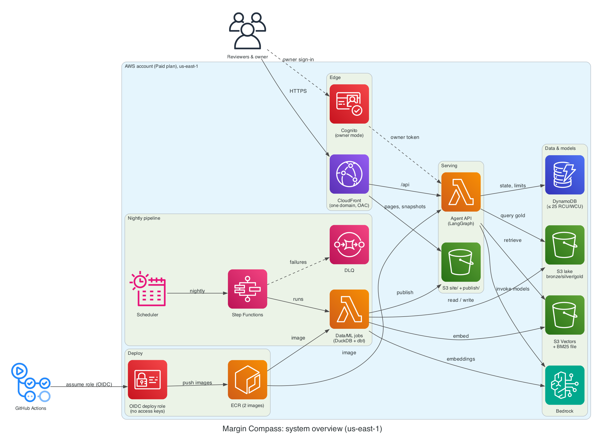
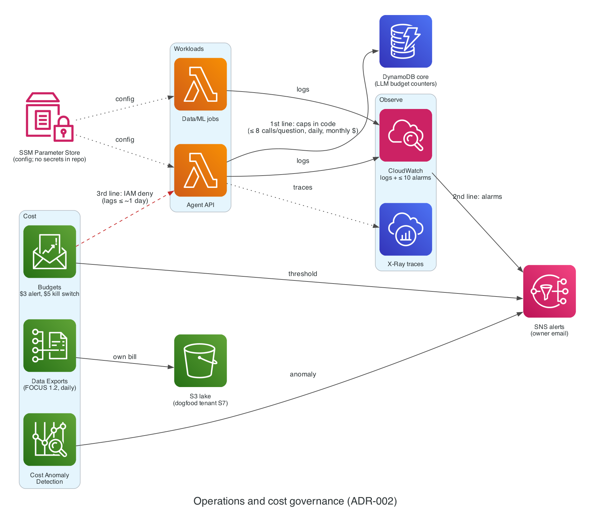

# ADR-002: Region: us-east-1

- **Status:** Accepted (2026-11-03, by the owner)
- **Date:** 2026-11-02
- **Related:** PLAN.md §10.2, ADR-003, ADR-008, VER-03, VER-04, VER-05, VER-10

## Context

Everything runs in one Region. The Region must offer S3 Vectors and the Bedrock models in ADR-003, and should sit where AWS delivers the FOCUS billing export.

## Decision

Deploy all stacks to **us-east-1**.

### Diagram

*System overview: every service runs in us-east-1.* Source: [`docs/diagrams/overview.py`](../diagrams/overview.py).

*Operations and cost governance: three lines of defense against runaway spend (code caps, alarms, Budgets kill switch).* Source: [`docs/diagrams/governance.py`](../diagrams/governance.py).

## Alternatives

| Option | Why not |
| --- | --- |
| eu-west-1 | S3 Vectors is available, but the FOCUS export is hosted in us-east-1, and Bedrock model availability there was not checked |
| eu-west-3 | Same as eu-west-1 |

## Consequences

- One Region keeps IaC, IAM, and cost simple.
- Free allowances for DynamoDB are per Region, so a single Region uses them fully.
- BoonCore's simulated "EU-only" tenants (ADR-017) are data in the simulator; they don't require an EU deployment.
- **Revisit if** an ADR-003 model leaves us-east-1 or a lower-cost Region gains all required services.

## Cost impact

$0 difference versus alternatives at this scale.

## Verified on

2026-11-02 (VER-03, VER-04): S3 Vectors is available in us-east-1 and the EU Regions above; the FOCUS 1.2 export is hosted in us-east-1. Bedrock documents prompt caching as available wherever a model is offered; per-Region model availability for ADR-003 is confirmed in the console at M0-07.
