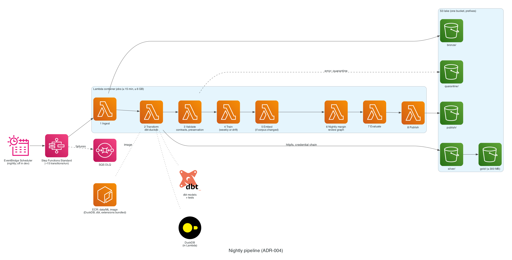

# ADR-004: Transform engine: DuckDB + dbt in Lambda

- **Status:** Proposed
- **Date:** 2026-11-02
- **Related:** PLAN.md §6.2 Stage 2, §7.5, VER-12

## Context

Gold data is ≤ 300 MB and jobs run nightly. The engine must cost $0 at rest and use industry-standard tooling.

## Decision

**DuckDB + dbt (dbt-duckdb)** in a Lambda **container image**, reading and writing Parquet on S3 via `httpfs` with a credential-chain secret. Extensions are bundled in the image. Athena stays optional for ad-hoc SQL.

### Diagram

*Nightly pipeline: Step Functions runs eight Lambda container jobs over the S3 lake.* Source: [`docs/diagrams/pipeline.py`](../diagrams/pipeline.py).

## Alternatives

| Option | Why not |
| --- | --- |
| Glue ETL | Per-DPU-hour cost; forbidden (§11.2) |
| EMR Serverless | Overkill; cost |
| Athena-only | Pay per scan; weaker local development |

## Consequences

- Same engine locally and in AWS (AGENTS.md rule 12).
- Jobs must fit 15 minutes and the configured memory.
- **New accounts have reduced Lambda memory quotas.** Check Service Quotas in M0-07; §7.5 needs up to 6 GB.
- **Revisit if** a nightly job approaches 10 minutes or 6 GB, or gold data approaches 300 MB.

## Cost impact

$0 within Lambda free allowances; ECR storage ≈ $0.10–0.25/month (§11.1).

## Verified on

2026-11-02 (VER-12): Lambda limits verified (10,240 MB memory, 15 min, `/tmp` up to 10,240 MB, 10 GB images, reduced quotas on new accounts). dbt-duckdb-on-Lambda pattern from secondary sources; proven in M1-02.
