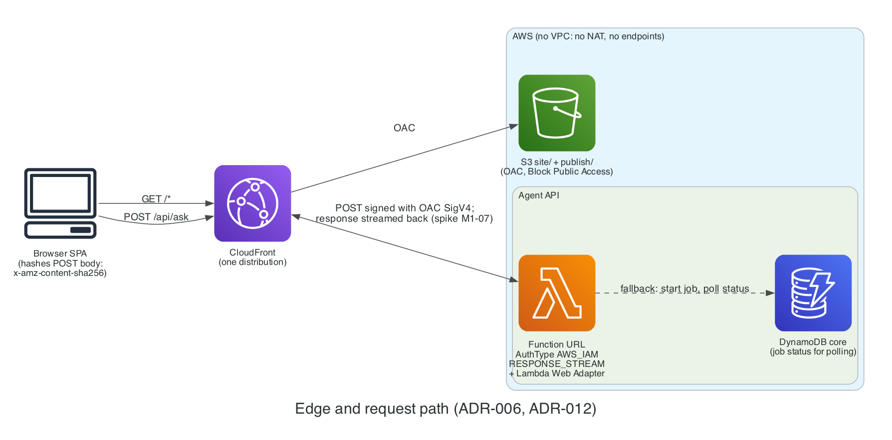

# ADR-006: Networking: no VPC for Lambdas

- **Status:** Proposed
- **Date:** 2026-11-02
- **Related:** PLAN.md §10.2, §11.2

## Context

VPC-attached Lambdas reaching AWS APIs need a NAT Gateway or interface endpoints. Both are billed per hour, so they can't scale to zero.

## Decision

Lambdas run **outside any VPC**. Access control relies on IAM, CloudFront OAC, and resource policies. No resource requires a VPC.

### Diagram

*No VPC: CloudFront reaches S3 and the Lambda function URL through OAC.* Source: [`docs/diagrams/edge.py`](../diagrams/edge.py).

## Alternatives

| Option | Why not |
| --- | --- |
| VPC + NAT Gateway | Billed per hour; forbidden (§11.2) |
| VPC + interface endpoints | Billed per endpoint per hour; forbidden (§11.2) |

## Consequences

- No private networking; data stores are reached over AWS APIs with IAM.
- Function URLs inside a VPC can't stream responses (VER-07), another reason to stay out.
- **Revisit if** a private-only data store becomes necessary (it would also need its own ADR).

## Cost impact

$0 (avoids NAT and endpoint costs).

## Verified on

2026-11-02 (VER-07): AWS docs confirm function URLs don't support response streaming within a VPC.
