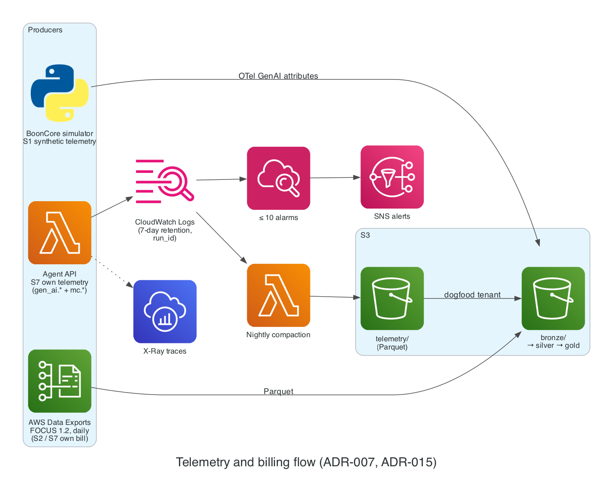

# ADR-007: Agent observability: telemetry lake + X-Ray

- **Status:** Proposed
- **Date:** 2026-11-02
- **Related:** PLAN.md §14, AGENTS.md rule 16, VER-02, VER-13

## Context

Agents need traces, token counts, and cost per question without always-on infrastructure and without storing prompt or response content.

## Decision

Structured logs with `run_id` to CloudWatch (7-day retention), traces to **X-Ray**, and long-term telemetry compacted to S3 (`telemetry/`) following the OTel GenAI attributes (ADR-015). An external tracing tool is allowed only on a free tier and only with metadata.

### Diagram

*Telemetry flow: logs and traces stay short-lived; compacted Parquet in S3 is the long-term store.* Source: [`docs/diagrams/telemetry.py`](../diagrams/telemetry.py).

## Alternatives

| Option | Why not |
| --- | --- |
| Self-hosted tracing (e.g., Langfuse on ECS) | Always-on compute; forbidden |
| CloudWatch only | Beyond the 5 GB free allowance, long retention costs more than compacted Parquet in S3 |

## Consequences

- Content never leaves the request path (rule 16).
- ≤ 10 alarms keeps CloudWatch at $0.
- The X-Ray free allowance is from a secondary source; confirm on the bill after M1.
- **Revisit if** trace volume nears the free allowance or a free external tool adds evaluation value.

## Cost impact

$0 within free allowances.

## Verified on

2026-11-02 (VER-02): CloudWatch 10 alarms / 5 GB logs verified; X-Ray 100k traces recorded per month from a secondary source.
