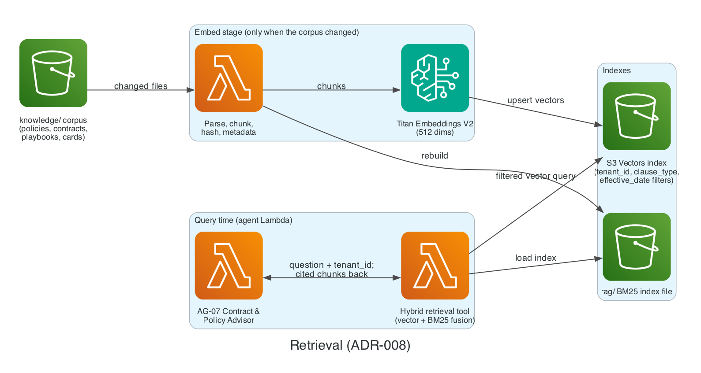

# ADR-008: Vector store: S3 Vectors + in-Lambda BM25

- **Status:** Accepted (2026-11-03, by the owner)
- **Date:** 2026-11-02
- **Related:** PLAN.md §6.2 Stage 5, VER-03

## Context

The corpus is small (policies, contracts, playbooks, cards). Retrieval needs tenant-filtered vector search plus keyword matching.

## Decision

**S3 Vectors** with metadata filters (`tenant_id`, `clause_type`, `effective_date`) for semantic search, fused with **BM25** over a small index file loaded in Lambda. LanceDB-on-S3 is the fallback.

### Diagram

*Retrieval: tenant-filtered S3 Vectors search fused with an in-Lambda BM25 index.* Source: [`docs/diagrams/retrieval.py`](../diagrams/retrieval.py).

## Alternatives

| Option | Why not |
| --- | --- |
| OpenSearch Serverless | Minimum capacity cost; forbidden |
| pgvector on RDS | Always-on database; forbidden |
| Bedrock Knowledge Bases with S3 Vectors | Semantic search only, no hybrid; managed chunking hides the structure-aware chunking we need |
| Bedrock Knowledge Bases with OpenSearch | Hybrid search, but OpenSearch is forbidden (§11.2) |

## Consequences

- Filterable metadata must stay under 2 KB per vector; contract text goes in non-filterable metadata or the chunk store.
- 512-dimension embeddings (ADR-003) keep storage tiny.
- **Revisit if** S3 Vectors adds keyword or hybrid search (drop the BM25 file) or the corpus outgrows a Lambda-loaded BM25 index.

## Cost impact

< $0.10/month (§11.1). At thousands of 512-d vectors, storage is a fraction of a cent.

## Verified on

2026-11-03 (VER-03): availability in us-east-1, limits (1–4,096 dims, 2 KB filterable metadata, top-K 10,000), GA status, and pricing ($0.06/GB-month, $2.50 per million queries) verified on 2026-11-02. Bedrock Knowledge Bases on S3 Vectors supports semantic search only, not hybrid, per the [AWS S3 User Guide](https://docs.aws.amazon.com/AmazonS3/latest/userguide/s3-vectors-bedrock-kb.html) (checked 2026-11-03).
