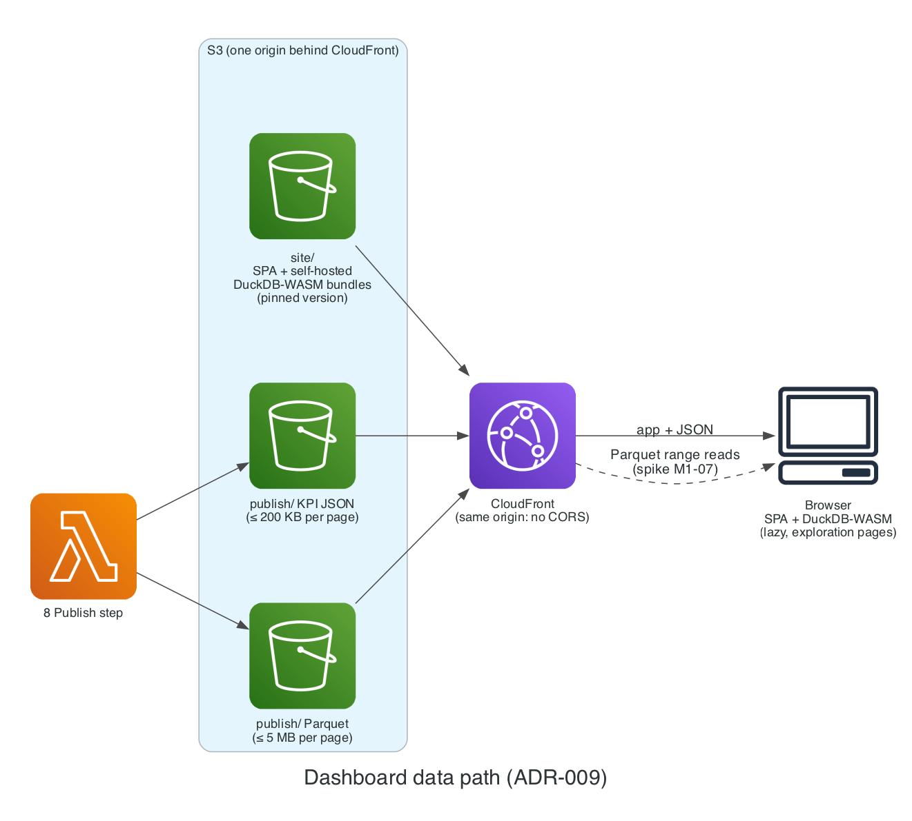

# ADR-009: Dashboard data: static SPA with JSON + lazy DuckDB-WASM

- **Status:** Proposed
- **Date:** 2026-11-02
- **Related:** PLAN.md §9, §7.5, VER-11

## Context

The dashboard must cost $0 to serve and stay interactive, including the Pricing Simulator.

## Decision

A **static SPA** on S3 + CloudFront. KPI pages load small JSON snapshots; exploration pages lazily load **DuckDB-WASM** and query Parquet from `publish/` on the **same CloudFront distribution**. Supply-chain controls:
- pin an exact, advisory-free `@duckdb/duckdb-wasm` version (never 1.29.2) with a committed lockfile and `npm ci`;
- serve the wasm bundles from our own distribution, not a public CDN;
- run a dependency audit in CI.

### Diagram

*Dashboard data path: one CloudFront origin serves the app, the self-hosted DuckDB-WASM bundles, and the snapshots.* Source: [`docs/diagrams/dashboard.py`](../diagrams/dashboard.py).

## Alternatives

| Option | Why not |
| --- | --- |
| Server-rendered BI (QuickSight) | Per-user cost; forbidden |
| API-backed charts | Compute per page view |

## Consequences

- Same origin means no CORS configuration.
- **Open:** wasm bundle size and Parquet range reads through CloudFront; spike in M1-07.
- **Revisit if** the spike shows range reads fail or the wasm bundle makes first load too slow; fall back to pre-aggregated JSON for those pages.

## Cost impact

$0 within CloudFront and S3 free allowances.

## Verified on

2026-11-02 (VER-11): WASM bundle variants and httpfs limits verified on DuckDB docs; the malicious 1.29.2 release confirmed via OSV and GitLab advisories (CVE-2025-59037).
