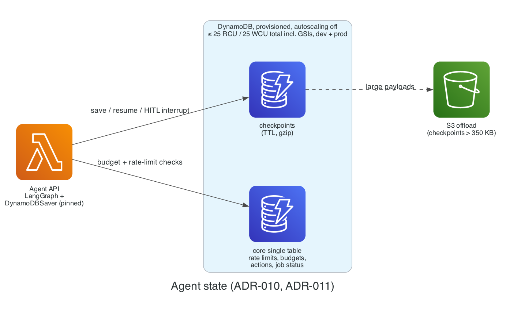

# ADR-010: Agent framework: LangGraph

- **Status:** Proposed
- **Date:** 2026-11-02
- **Related:** PLAN.md §8, VER-09

## Context

The agent system needs explicit graphs, durable state, human-in-the-loop interrupts, and replayable runs.

## Decision

**LangGraph** with the `DynamoDBSaver` checkpointer from `langgraph-checkpoint-aws`, pinned to an exact version, with TTL, gzip compression, and S3 offload for checkpoints over 350 KB.

### Diagram

*Agent state: LangGraph checkpoints in DynamoDB, with large payloads offloaded to S3.* Source: [`docs/diagrams/agent_state.py`](../diagrams/agent_state.py).

## Alternatives

| Option | Why not |
| --- | --- |
| CrewAI, AutoGen | Less explicit control flow; weaker durable state |
| Bedrock Agents | Less control over graph, verifier, and replay |
| Bedrock AgentCore runtime | Another managed service to cost-model (Paid-plan only, VER-01); LangGraph on Lambda already meets the need |

## Consequences

- The checkpointer package is maintained by the LangChain org, not AWS; pin and review upgrades.
- Local runs use DynamoDB Local through the saver's `endpoint_url`.
- **Revisit if** the checkpointer stops being maintained or breaks with a LangGraph major release.

## Cost impact

$0 (DynamoDB within the free capacity; S3 offload is rare).

## Verified on

2026-11-02 (VER-09): `langgraph-checkpoint-aws` 1.2.6 (2026-10-23), MIT, Python ≥ 3.10; features verified in the AWS developer guide.
