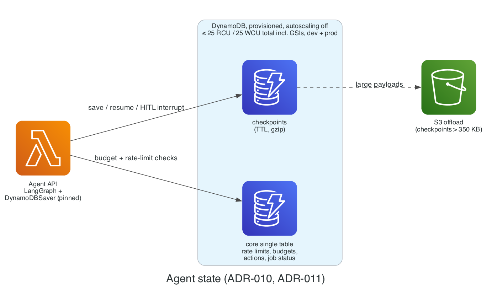

# ADR-011: Operational store: DynamoDB provisioned, single-table

- **Status:** Proposed
- **Date:** 2026-11-02
- **Related:** PLAN.md §10.1, AGENTS.md rule 2, VER-02, VER-09

## Context

Rate limits, budgets, action records, and agent checkpoints need a serverless store that costs $0 at rest.

## Decision

**DynamoDB in provisioned mode, autoscaling off**: a `core` single table and a `checkpoints` table per environment, total **≤ 25 RCU and ≤ 25 WCU** across all tables **and their GSIs**, in both `dev` and `prod`. Clients use adaptive retries; checkpoints use TTL to cap storage.

### Diagram

*Both tables share one provisioned capacity budget of 25 RCU / 25 WCU.* Source: [`docs/diagrams/agent_state.py`](../diagrams/agent_state.py).

## Alternatives

| Option | Why not |
| --- | --- |
| On-demand mode | The free RCU/WCU allowance applies to provisioned capacity; on-demand is forbidden (AGENTS.md rule 2) |
| RDS / Aurora | Always-on; forbidden |

## Consequences

- Throttling is possible under bursts; the API returns a friendly retry and the rate limiter keeps load low.
- AWS's checkpointer example uses on-demand; we deliberately deviate.
- **Revisit if** throttling shows up in normal (non-abuse) traffic.

## Cost impact

$0 within 25 GB / 25 RCU / 25 WCU per Region.

## Verified on

2026-11-02 (VER-02, VER-09): free capacity verified per Region per payer account; the checkpointer documents provisioned-mode throttling handling.
