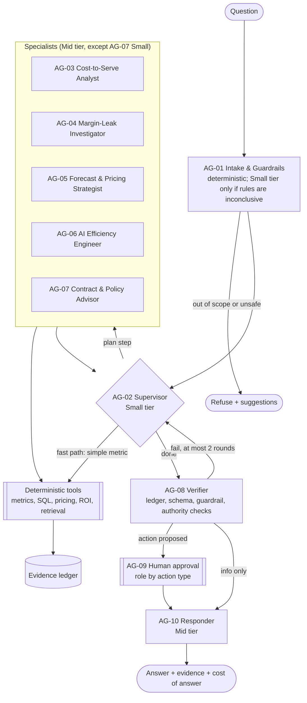

# ADR-013: Agent topology: 5 specialists + deterministic nodes, with a fast path

- **Status:** Accepted (2026-11-03, by the owner)
- **Date:** 2026-11-02
- **Related:** PLAN.md §8.2–§8.3, AGENTS.md rules 3–4

## Context

More LLM agents raise cost, latency, and evaluation surface. Numbers must never come from the LLM.

## Decision

A LangGraph supervisor (AG-02, Small tier) routes to **five specialists** (AG-03…AG-07), and a responder (AG-10) writes the answer. Intake and guardrails (AG-01) are mostly deterministic; the verifier (AG-08) does deterministic ledger, schema, guardrail, and authority checks, with an LLM used only for citation support. Human approval (AG-09) is an interrupt. **All calculations are deterministic tools.** A fast path answers simple metric questions without the full graph. Each question typically uses 3–5 LLM calls and is capped at **8**.

### Diagram

Every number in the answer comes from a tool and is recorded in the evidence ledger. The whole run is capped at 8 LLM calls.

## Alternatives

| Option | Why not |
| --- | --- |
| 10 LLM agents | Higher cost and latency; harder to evaluate |
| Single agent | Weaker separation of concerns and tool allow-lists |

## Consequences

- Adding an agent needs a new ADR (AGENTS.md rule 4).
- AG-07 also enforces ADR-017 constraints (approved models, residency, safety floor).
- **Revisit if** replay evaluations show a specialist adds no accuracy over a tool, or the 8-call cap is regularly hit.

## Cost impact

Contained in the ADR-003 LLM budget.

## Verified on

Not applicable: design decision with no external facts (2026-11-03).
