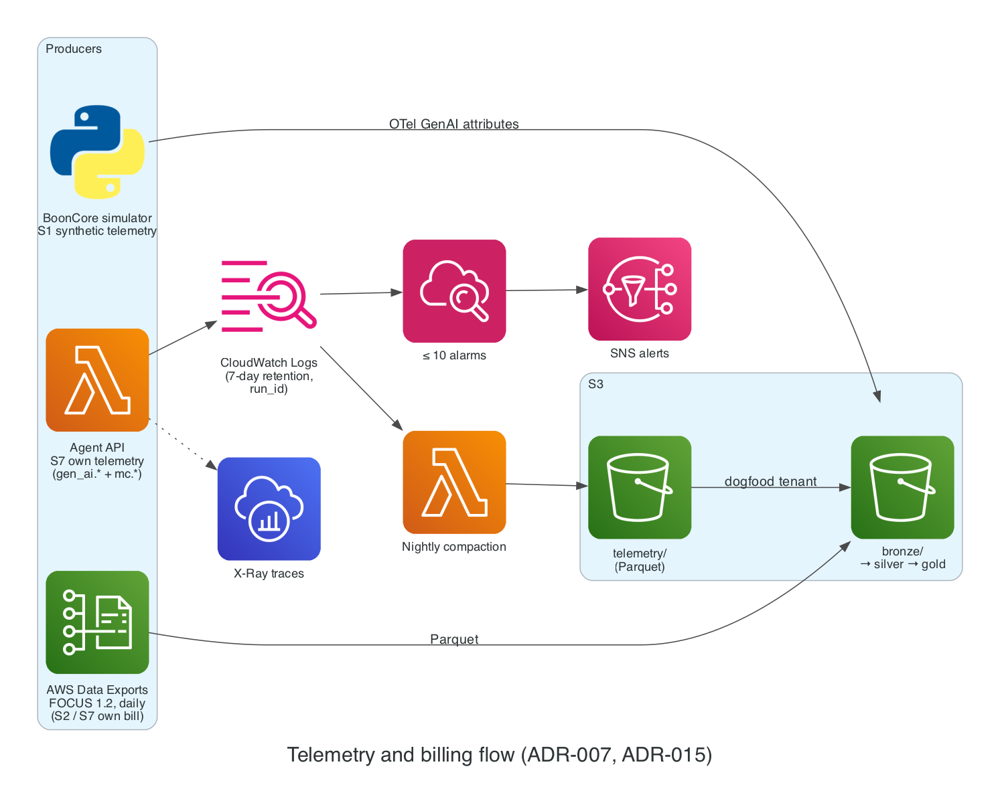

# ADR-015: Telemetry standard: OpenTelemetry GenAI conventions + FOCUS 1.2

- **Status:** Proposed
- **Date:** 2026-11-02
- **Related:** PLAN.md §6.2 Stage 1, ADR-007, VER-10, VER-13

## Context

Telemetry and billing schemas should be portable to real companies and credible to reviewers.

## Decision

- **LLM telemetry (S1, S7):** OpenTelemetry GenAI attributes, pinned in the S1 data contract as of 2026-11-02: `gen_ai.operation.name`, `gen_ai.provider.name` (`aws.bedrock` for the platform's own calls), `gen_ai.request.model`, `gen_ai.response.model`, `gen_ai.usage.input_tokens`, `gen_ai.usage.output_tokens`, `gen_ai.usage.cache_read.input_tokens`, `gen_ai.usage.cache_write.input_tokens`, `gen_ai.conversation.id`, `gen_ai.agent.name`. One bronze → silver mapping absorbs convention changes.
- **Project attributes** for fields OTel doesn't define, under an `mc.` prefix: `mc.tenant_id`, `mc.feature_id`, `mc.retry_count`, `mc.agent_step_count`, `mc.outcome_id`, and `mc.run_id`. BoonCore's fictional providers use `gen_ai.provider.name` values `provider_a`, `provider_b`, `provider_c`.
- **Billing (S2, S7):** **FOCUS 1.2** via AWS Data Exports, Parquet, daily refresh.

### Diagram

*Where the OTel GenAI (S1, S7) and FOCUS 1.2 (S2, S7) data enter the lake.* Source: [`docs/diagrams/telemetry.py`](../diagrams/telemetry.py).

## Alternatives

| Option | Why not |
| --- | --- |
| Proprietary schemas | Not portable; less credible |
| FOCUS 1.0 | 1.2 is GA on AWS and adds `InvoiceId` and 13 other columns |

## Consequences

- The GenAI conventions are Development stability with no tagged release; expect renames. Re-check before M6.
- `gen_ai.usage.input_tokens` includes cached tokens; cost pricing must not double-count cache reads.
- **Revisit** before M6, or when the conventions publish a tagged release.

## Cost impact

$0 (Data Exports itself is free; storage in S3 is pennies).

## Verified on

2026-11-02 (VER-10, VER-13): FOCUS 1.2 export GA (2025-11-19), Parquet, daily refresh; GenAI attribute names and status read from the semantic-conventions-genai repository.
